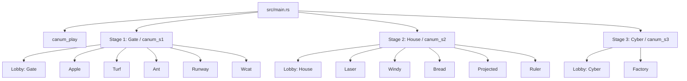

# Canum Design Patterns: Stage → Level → Mechanics

This document describes how content is organized and implemented in the Canum workspace, from the largest
unit (a **stage**) down to individual **levels** and the reusable **mechanics** they are built from.

> **Precedence rule:** when patterns conflict, the newer stage wins:
> **Stage 3 (Cyber) > Stage 2 (House) > Stage 1 (Gate)**.
> A lot of `canum_s1`/`canum_s2` code is retained only to support older content (for example the
> `canum_tool::weapon::old_laser` module used by the House `Laser` level). Do **not** copy legacy patterns
> into new levels. Section [7. Legacy vs current patterns](#7-legacy-vs-current-patterns) is the authority on
> what to use for new work.

---

## 1. Hierarchy at a glance

| Layer | Meaning | Code location | Key identifier |
| --- | --- | --- | --- |
| Workspace | App, shared plugins, states, save, UI, FX | `src/main.rs`, `canum_play`, `canum_res`, `canum_ui`, `canum_fx`, `canum_addons`, `canum_tool`, `canum_save` | `App`, `Plugin`, `Fight` |
| Stage | A narrative/asset grouping with one hub lobby, its boss levels, shops and add-ons | `canum_s1` = Gate, `canum_s2` = House, `canum_s3` = Cyber | stage key in `CONFIG.values.stage` |
| Level | One playable fight or hub, driven by a single Bevy `State` value | one module such as `canum_s2/src/windy.rs` | `setup::Fight("Windy".to_owned())` |
| Mechanics | Reusable ECS behavior: damage, movement, behaviors, projectiles, UI, FX | mostly `canum_play`, `canum_fx`, `canum_ui`, `canum_tool` | components/events/systems |



### 1.1 Vocabulary

- **Stage crate** — `canum_sN`. It owns a stage's levels, its lobby, and (in `canum_addons`) any stage-specific
  charm/add-on code. Stages do not depend on each other.
- **Level** — a `setup::Fight(String)` state. The string is the level key, e.g. `"Apple"`, `"Windy"`,
  `"Factory"`. Lobbies are levels too (`"Gate"`, `"House"`, `"Cyber"`).
- **Special `Fight` states** — intermediate flows:
  - `"LobbySelect"` — resolves to `save.progress.current_lobby`.
  - `"Victory"` — dummy victory level that immediately returns to `"LobbySelect"`.
  - `"Shop_Ant"`, `"Shop_Bread"` — shop levels, rendered under `PlayState::Shop`.
  - `"_GetDash"`, `"_GetSecondaryWeapon"` — scripted reward cutscenes. Names starting with `_` are treated as
    in-between states by shared tracking code, e.g. `canum_play/src/player/tracking.rs`.
- **Session** — everything belonging to the current fight. Entities marked `SessionOnly` are despawned when a new
  `StartSession` starts.

---

## 2. Cross-stage runtime contracts

These are not stage-specific and every level relies on them.

### 2.1 States and the session lifecycle

The state machine lives in `canum_play/src/setup.rs`:

- `GameState`: `Play` / `Cutscene`.
- `PlayState`: `Fighting` / `Lobby` / `Shop` (the mode used while `GameState::Play` is active).
- `Fight(String)`: the current level key.
- `FightTime`: elapsed time in the current fight.
- `StartSession { fight }`: the **only** supported way to enter a level.
- `StartSessionFirst` → `StartSessionMiddle` → `StartSessionAction` → `StartSessionBaseUi` →
  `StartSessionAddedUi`: ordered setup phases, spread over about five frames.
- `InitializationComplete` / `in_stable_state(state)`: use for systems that must not run until all setup phases
  have completed (e.g. lobby camera follow in `canum_play/src/setup/lobby.rs`).

Session cleanup uses:

- `SessionOnly` — despawn on session change. `Friendly` and `Projectile` already require it, so most gameplay
  entities are cleaned up automatically.
- `ChildSessionOnly` — despawn the children of the marked entity on session change. `canum_ui/src/setup.rs`
  uses it on most UI anchors (`BottomRight` is intentionally left persistent for global popups such as
  achievements).
- `CutsceneDelete` — despawn when entering a cutscene.
- `CutsceneWait` — keep a cutscene alive until these entities are gone.
- `CutsceneNext` — the next `StartSession` to run after the cutscene.

Standard entry points:

- App startup: `src/main.rs` triggers `StartSession { fight: "LobbySelect" }`.
- Lobby select: `canum_play/src/setup/lobby.rs::select_lobby` maps `"LobbySelect"` to
  `save.progress.current_lobby`.
- Boss panel / stage door: `canum_ui/src/lobby/boss.rs` and stage `lobby.rs` spawn a `PureColorCutscene`.
- Victory: `canum_play/src/player/victory.rs` moves to `"Victory"` and then back to `"LobbySelect"`.
- Failure: `canum_play/src/player/failure.rs` returns to `"LobbySelect"` and increments `fail_times`.

### 2.2 Shared plugin root

`canum_play/src/lib.rs` installs the reusable mechanics:

```rust
PlayerPlugin, ControlsPlugin, MovementsPlugin, HealthPlugin,
SetupPlugin, EnemyPlugin, ProjectilePlugin, ObstaclePlugin
```

Stage crates only add their level plugins:

```rust
// canum_s1/src/lib.rs
app.add_plugins((
    apple::ApplePlugin, lobby::LobbyPlugin, turf::TurfPlugin,
    ant::AntPlugin, runway::RunwayPlugin, wcat::WcatPlugin,
));

// canum_s2/src/lib.rs
app.add_plugins((
    lobby::LobbyPlugin, laser::LaserPlugin, windy::WindyPlugin,
    bread::BreadPlugin, projected::ProjectedPlugin, ruler::RulerPlugin,
));

// canum_s3/src/lib.rs (current pattern)
app.add_plugins((lobby::LobbyPlugin, factory::FactoryPlugin));
```

### 2.3 Where stage-specific add-ons live

`canum_addons` mirrors the stage numbering:

- `canum_addons/src/charms/s1.rs`
- `canum_addons/src/charms/s2.rs`
- new stages should add `s3.rs`, etc.

They react to the `StartSession*` phases instead of being hard-coded into a level. This is why a charm can work
in every fight without any boss code knowing about it.

---

## 3. Stage 1 — Gate (`canum_s1`)

Gate is the oldest stage and is kept mainly as legacy content. Use it for reference on **level structure**, not
for new animation/session-observer code.

### 3.1 Stage shell

- Crate plugin: `CanumS1Plugin` in `canum_s1/src/lib.rs`.
- Hub level: `Fight("Gate")`, implemented by `canum_s1/src/lobby.rs`.
- Boss levels: `Apple`, `Turf`, `Ant`, `Runway`, `Wcat`.
- Config: `assets/values/gate.ron`
  - Shop: `Shop_Ant`.
  - Lock before Wcat: requires `Apple` and `Ant`.
  - Lock before House: requires `Apple`, `Ant`, `Wcat`.
  - Stage completion: `complete_prereqs: ["Wcat"]`.

#### Frequently used symbols

| Layer | Symbols |
| --- | --- |
| Stage | `CanumS1Plugin`, `LobbyPlugin` |
| Level identity | `Fight("Apple")`, `APPLE_STATE`, `Fight("Turf")`, `TURF_STATE`, etc. |
| Level modules | `EntryPlugin`, `BehaviorsPlugin`, `DefeatPlugin`, `BackgroundPlugin` |
| Boss markers | `AppleBoss`, `TurfBoss`, `AntBoss`, `RunwayBoss`, `RunwayLion`, `WcatBoss` |

### 3.2 Level: Gate lobby

File: `canum_s1/src/lobby.rs`

- `LobbyPlugin` registers `OnEnter(Fight("Gate"))`.
- `setup_lobby` spawns `CutsceneDelete` observers:
  - `handle_lobby_select` — boss panels indexed by `event.position.x / 800.0`.
  - `handle_lobby_shop` — enters `Shop_Ant` when the player is at index `2` and the shop exists.
  - `quit_lobby_panel` — removes the boss panel on `LobbyQuit`.
- The shop indicator is spawned only after `Ant` is defeated.
- The door to the next stage is index `5`, using `setup::cutscene::PureColorCutscene` to enter `House`.

Shared lobby machinery lives in `canum_play/src/setup/lobby.rs`:

- Resources: `LobbySize`, `LobbyName`.
- Events: `LobbySelect { position }`, `LobbyShop { position }`, `LobbyQuit`.
- `get_marks(save, name)` — builds `Mark_*` icon names for the boss panel.
- Boundary/lock generation from `CONFIG.values.stage[stage].locks`.

Lobby UI helper: `canum_ui::lobby::boss::boss_panel(...)`; panel select handling is in
`canum_ui/src/lobby/boss.rs`. Locks and their proximity text are handled by
`canum_ui/src/lobby/lock.rs`; coins by `canum_ui/src/lobby/coin.rs`.

### 3.3 Level: Apple

Files: `canum_s1/src/apple.rs`, `apple/background.rs`, `apple/behaviors.rs`, `apple/defeat.rs`.

- Start is background-driven: `AppleTreeChanged` waits two seconds of `FightTime`, swaps the background with
  `PureColor`, and emits `AppleTreeBackgroundChanged`, which spawns the boss.
- `AppleBoss` is a standard health boss:
  - `Animation`, `RigidBody::Dynamic`, circular collider, `Friendly(false)`, `ContactDamage`, `SpeedDecay`,
    `EnemyHealth`, `DamageSound`, `DefeatToWin`, `AppleDefeat`.
- Behaviors (`AppleBehaviors` manager):
  - `MoveCloser` — `Displacement` toward the player, `BaseFartherBetter`.
  - `ThrowSlice` — animation inform then spawns `AppleSlice`, `BaseByDistance`.
  - `PeelSkin` — radial `AppleSkin` projectiles; added at health ≤ 2000 and buffed at ≤ 1000 by
    `change_stage` in `apple/behaviors.rs`.
- Defeat: `AppleDefeat` plays `Apple_Defeat`, then despawns the boss on `AnimationComplete`. Despawning the
  boss (or otherwise removing `DefeatToWin`) is what actually triggers the win.

### 3.4 Level: Turf

Files: `canum_s1/src/turf.rs`, `turf/background.rs`, `turf/behaviors.rs`, `turf/defeat.rs`.

- Timer-survival level: `TurfBoss` has a 90-second `Timer` and **no** `EnemyHealth`.
- `turf_count_down` ticks with `Time<Real>`; when finished, sets `DefeatToWin.defeated` and despawns the boss.
- `TurfStage` is derived from the elapsed ratio in `turf/behaviors.rs`; at stage 1 it adds the
  `TurfSpawnShooter` behavior to the manager.
- Behaviors:
  - `TurfSpawnSpiker` → `TurfSpiker` (run-in, then turn into a spinning projectile).
  - `TurfSpawnShooter` → `TurfShooter`, which rises and fires `TurfShooterSeed`.
- `TurfDefeat` only changes the background; the win path is the timer.

Use this level as the reference for **timer-based win conditions** and staged obstacle spawning.

### 3.5 Level: Ant

Files: `canum_s1/src/ant.rs`, `ant/background.rs`, `ant/entry.rs`, `ant/behaviors.rs`, `ant/defeat.rs`.

- `AntSetupTimerComplete` (from `ant/background.rs`) spawns the boss and `AntBehaviors`.
- `AntEntry` is a small component-driven intro: it spawns a `Displacement` into the arena, then on
  `DisplacementComplete` removes `NoCollideBoundary`, resets the animation and emits `AntEntryComplete`.
- `AntBoss` is a standard health boss with `EnemyHealth(3500)` and `AntDefeat`.
- Health bar is spawned only after `AntEntryComplete`, guarded by `ShowHealth`.
- `AntDefeat` plays the defeat animation and despawns on `AnimationComplete`.

This is the reference for a **scripted entry sequence before a normal boss fight**.

### 3.6 Level: Runway

Files: `canum_s1/src/runway.rs`, `runway/entry.rs`, `runway/running.rs`, `runway/obstacles.rs`,
`runway/problem.rs`, `runway/defeat.rs`.

- Not a health boss:
  - `RunwayBoss` is only a win marker (`SessionOnly`, `Friendly(false)`, `DefeatToWin`).
  - `RunwayLion` is the visible pursuer.
  - `RollingSpeed` + `RollingVelocity` scroll the world; `BackgroundRotation` loops the backdrop.
- Entry (`entry.rs`):
  - `StartRunwaySetup` moves the player, spawns the lion, then `RunwayOfficialStart` starts music, obstacles
    and rolling speed.
  - The screen edge uses `BumpAway` + `CollidePlayerOnly` to keep the player inside.
- Obstacles (`obstacles.rs`):
  - `ObstacleBehaviors` is a `BehaviorManager`; behaviors are `RotatingBar`, `StaircaseBars`, `SpawnTree`,
    `SpawnBoxAndBar`.
  - `Obstacle` base requirement handles collision, contact damage, cleanup and forced velocity.
- Win condition (`problem.rs` + `defeat.rs`):
  - `Problem` math questions are generated with weighted digits.
  - Five correct answers (`ProblemSuccessCount >= 5`) set `DefeatToWin.defeated`, remove it, stop rolling and
    play the lion defeat animation.
- The `RunwayOfficialStart` event / `RunwayBoss` marker is a good example of a level whose "boss" is a
  rule/score condition rather than an `EnemyHealth` entity.

### 3.7 Level: Wcat

Files: `canum_s1/src/wcat.rs`, `wcat/entry.rs`, `wcat/behaviors.rs`, `wcat/behaviors/phase1.rs`,
`wcat/behaviors/phase2.rs`, `wcat/behaviors/bar.rs`, `wcat/defeat.rs`.

- `WcatBoss` is a standard health boss (`EnemyHealth(5000)`) plus `StaggerTimes` and `WcatDefeat`.
- Entry choreography uses `WcatStartTrigger` → dialogue (`Dialogue::from_config("Wcat_Prefight")`) →
  `WcatFightStartTrigger` → music.
- `initialize_behaviors` adds `WcatPhase1` with `HighLunge`, `PlainLunge`, `WanderAround`, `PassTime`.
- Phase 2 swaps the behavior set (`wcat/behaviors/phase2.rs`).
- `HighLunge` / `PlainLunge` / `WanderAround` implement `BehaveIntervene` observers for staggering; this is
  the "Use 1" intervention style (each behavior handles its own forced stop).
- Defeat transitions to `_GetDash`, which unlocks the dash and then returns to `"LobbySelect"`.

This is the reference for **multi-phase bosses with intervention-based staggering**.

### 3.8 Stage 1 mechanics and legacy notes

Gate demonstrates the following mechanics, but in their older form:

- `canum_res::Animation::new` + `Animation::replace` + `AnimationInform` for sprite state.
- Manual session observers: `commands.spawn((SessionOnly, Observer::new(fn)))`.
- Setup delays implemented with a `Timer` resource (`SetupTimer`, `EntryTimer`) instead of
  `wait_then_trigger!`.
- Repeated `run_if(in_state(STATE.clone()))` instead of a level `SystemSet`.
- Raw numeric `ContactDamage` values instead of `consts::damage::*`.

Keep these patterns inside `canum_s1`; do not introduce them into new levels.

---

## 4. Stage 2 — House (`canum_s2`)

House is a transitional stage: it uses the newer session macros and the new `LaserLike` in Ruler, while still
relying on `canum_res::Animation` and the deprecated `old_laser` in the Laser level.

### 4.1 Stage shell

- Crate plugin: `CanumS2Plugin` in `canum_s2/src/lib.rs`.
- Hub level: `Fight("House")`, implemented by `canum_s2/src/lobby.rs`.
- Boss levels: `Laser`, `Windy`, `Bread`, `Projected`, `Ruler`.
- Config: `assets/values/house.ron`
  - Shop: `Shop_Bread`.
  - Lock before Ruler: requires `Laser`, `Bread`.
  - Lock before Cyber: requires `Laser`, `Bread`, `Ruler`.
  - Stage completion: `complete_prereqs: ["Laser", "Bread", "Ruler"]`.

#### Frequently used symbols

| Layer | Symbols |
| --- | --- |
| Stage | `CanumS2Plugin`, `LobbyPlugin` |
| Level identity | `LASER_STATE`, `WINDY_STATE`, `BREAD_STATE`, `PROJECTED_STATE`, `RULER_STATE` |
| Shared level modules | `EntryPlugin`, `BehaviorsPlugin`, `DefeatPlugin` |
| Boss markers | `LaserBoss`, `WindyMainEntity`, `BreadBoss`, `ProjectedMainEntity`, `RulerBoss` |
| Newer helpers | `session_observers!`, `wait_then_trigger!`, `SpriteSheet`, `LaserLike` |

### 4.2 Level: House lobby

File: `canum_s2/src/lobby.rs`

- Same shape as Gate: `setup_lobby` spawns `CutsceneDelete` observers for select/shop/quit.
- Boss panel indices: `0` Laser, `1` Windy, `2` Bread, `3` Projected, `4` Ruler, `5` door to Cyber.
- Shop (`Shop_Bread`) is available after `Bread` is defeated.
- Uses `get_marks` and `canum_ui::lobby::boss::boss_panel`, same as Gate.

### 4.3 Level: Laser

Files: `canum_s2/src/laser.rs`, `laser/entry.rs`, `laser/behaviors.rs`, `laser/defeat.rs`.

- `LaserBoss` requires `Animation`, dynamic body, rectangle collider, `LockedAxes::TRANSLATION_LOCKED`,
  `EnemyHealth(4000)`, `DamageSound`, `DefeatToWin`, `LaserDefeat`.
- `entry.rs` spawns background, boss, `EnemySensor`, `LaserBehaviors`, music, title and optional health bar.
- Behaviors:
  - `ShootAndRotate` — charges, spawns a beam and tracks the player; uses the deprecated
    `canum_tool::weapon::old_laser::LaserLike` and `LaserSpawn`.
  - `ScreenAttack` — chooses one of several grid/radial laser patterns, spawns `ScreenAttackBase` nodes,
    rotates the boss, then ends.
- `LaserDefeat` plays the defeat animation and despawns on `AnimationComplete`.
- **Legacy warning:** this is the only level that should use `old_laser`. New beam/laser code must use
  `canum_tool::weapon::laser::LaserLike` with `SpriteSheet`, as Ruler does.

### 4.4 Level: Windy

Files: `canum_s2/src/windy.rs`, `windy/entry.rs`, `windy/behaviors.rs`, `windy/obstacles.rs`, `windy/wind.rs`.

- Survival/timer boss: `WindyMainEntity` holds the total timer (114.5 s) and stage timers. There is no enemy
  health bar; the bar is a countdown.
- `WindyCurrentStage` is a resource (`1`, `2`, `3`). `EnterStage2`, `EnterStage3`, `StopAttacks` events
  change wind strength, background animation and available attacks.
- `StageDelete` marks entities to remove on stage change.
- Wind mechanics (`wind.rs`):
  - `WindVelocity { target_velocity, friction }` — global resource.
  - `CanBeBlown(f32)` — per-entity multiplier; the component hook auto-spawns `WindForcedVelocity` as a child.
  - `WindForcedVelocity` requires `PartialVelocity` and applies wind in `FixedPreUpdate`.
- Obstacles:
  - `Spike`, `DestroyableObstacle`, `TumbleWeed`, `Pole`.
  - `Pole` builds its body from stacked sprites and a compound collider.
- Behaviors: `SpawnTumbleWeed`, `WaveOfSpikes`, `PoleStorm`, `TwoPoles`, all using `occupies!`; the
  `"Fullscreen"` resource (used by the screen-wide attacks) prevents overlapping full-screen attacks.
- Win: total timer finishes → `DefeatToWin.defeated = true` → remove `DefeatToWin`.

This is the reference for **environmental forces and stage-based attack sets**.

### 4.5 Level: Bread

Files: `canum_s2/src/bread.rs`, `bread/entry.rs`, `bread/behaviors.rs`, `bread/defeat.rs`,
`bread/projectiles.rs`.

- `BreadBoss { stage }` has `EnemyHealth(4400)`. `update_stage` maps health to four stages at thresholds
  3400 / 2400 / 1000.
- `BreadNextStage` triggers `switch_stages`, which:
  - clears the manager info (`BehaviorManagerInfo::clear`),
  - sets a global cooldown,
  - despawns all behavior children,
  - adds the behaviors for the new stage.
- Behaviors by stage:
  - Stage 1: `BumpAround`, `SpeedyDash`.
  - Stage 2: `RandomShoot`, `SimplyWander`.
  - Stage 3: `SpeedyDash`, `StreamSlash`.
  - Stage 4: `SuperRandomShoot`, `SimplyWander`.
- `projectiles.rs` contains bread-specific projectiles (`BreadSlice`, etc.).
- Defeat: `BreadDefeat` removes collider/rigidbody, spawns a `Meteor` that displaces in with `Displacement`,
  then removes `DefeatToWin` after a delay. This is the reference for a **staged defeat cutscene**.

### 4.6 Level: Projected

Files: `canum_s2/src/projected.rs`, `projected/entry.rs`, `projected/flashlight.rs`,
`projected/enemies.rs`, `projected/enemies/{mantis,bird,moon,apple}.rs`.

- `ProjectedMainEntity` is the win marker (`SessionOnly`, `Friendly(false)`, `DefeatToWin`).
- Waves are data-driven:
  - `CONFIG.values.custom["Projected_Waves"]` (defined in `assets/values/levels/projected.ron`) is parsed into
    `Waves { waves, current_value, total_value }`.
  - `PendingWave` spreads spawning across frames.
  - `AllDefeated` gates the end condition.
  - `update_enemy_wave` pops waves, `spawn_enemies` spawns one enemy per frame.
- `ProjectedEnemy` is the shared requirement bundle for minions (`EnemyHealth`, `DamageSound`,
  `ContactDamage`, `NoCollideBoundary`, movement, `Friendly(false)`, etc.).
- Most enemy modules own their own `BehaviorManager`; Moon is a direct-system exception.
  - Mantis: `AdjustPosition`, `DoSlash` with `SlashResidue` hitbox growth.
  - Bird: `RandomMoving`, `ShootFeather`.
  - Moon: orbiting `Star` projectiles, `moon_move_closer` (no manager).
  - Apple: `RandomMove`, `ThrowSlice`.
- `FlashlightOverlay` uses a mask of sprites to create the spotlight effect.
- Win: when all waves are empty and no enemies remain → `ProjectedAllDefeated` → after 2 s
  `ProjectedVictory` despawns the main entity.

This is the reference for **wave/minion levels with multiple small behavior managers**.

### 4.7 Level: Ruler

Files: `canum_s2/src/ruler.rs`, `ruler/entry.rs`, `ruler/behaviors.rs`,
`ruler/behaviors/{phase1,phase2,transition,laser}.rs`, `ruler/defeat.rs`.

- Two-phase boss:
  - Phase 1: `RulerPhase1` manager with `Swipe`, `LaserAttack`, `BounceBall`, `StrongLaser`.
  - `EnemyDefeated` is intercepted by `transition.rs`; it changes `RulerPhase::Phase1` to `Phase2`, removes
    phase-1 children, disables the parent collider with `ParentColliderDisabled`, plays a `Displacement`
    transition, then resets health to `PHASE2_HEALTH` and adds `RulerPhase2`.
  - Phase 2: `RulerPhase2` manager with the phase-2 behavior set.
- Entry (`entry.rs`) demonstrates a full scripted intro: dialogue (`Ruler_Prefight`), big title animation,
  `RulerStart`, music, `EnemySensor` and health bar.
- Laser attacks (`ruler/behaviors/laser.rs`) use the **current** `canum_tool::weapon::laser::LaserLike` with
  `SpriteSheet` middle/terminal sprites. Use this, not `old_laser`.
- Defeat (`defeat.rs`) plays `Ruler_Breaks`, fades out, then enters `_GetSecondaryWeapon` to unlock the second
  weapon slot and the offensive charm slot before returning to the lobby.

This is the reference for **phase transitions that reset health and rebuild behavior sets**.

### 4.8 Stage 2 mechanics and migration notes

House uses the newer session setup macros:

```rust
canum_fx::session_observers!(commands, fn_a, fn_b, fn_c);
canum_fx::wait_then_trigger!(use commands, SomeEvent, 0.5);
```

However, most visual code still uses `canum_res::Animation`. When touching House code, preserve the local style;
when adding new content, follow Stage 3.

---

## 5. Stage 3 — Cyber (`canum_s3`)

Cyber is the current reference implementation. New stages/levels should copy its structure and its newer
mechanics choices.

### 5.1 Stage shell

- Crate plugin: `CanumS3Plugin` in `canum_s3/src/lib.rs`.
- Hub level: `Fight("Cyber")`, implemented by `canum_s3/src/lobby.rs`.
- Boss level: `Factory`.
- Config: `assets/values/cyber.ron` (currently only the Factory boss entry).
- The stage uses private modules (`mod factory; mod lobby;`) rather than publicly exporting every level. This
  is fine for a new, self-contained stage.

#### Frequently used symbols

| Layer | Symbols |
| --- | --- |
| Stage | `CanumS3Plugin`, `LobbyPlugin` |
| Level identity | `FACTORY_STATE`, `FactorySystems` |
| Level modules | `EntryPlugin`, `RobotPlugin` |
| Boss | `RobotBoss`, `RobotBehaviors` |
| Current mechanics | `SpriteSheet`, `SpriteSheetQueue`, `SpriteSheetPlayer`, `SpriteSheetQueueUpdate`, `BehaviorProcess`, `MultiplierManual`, `MultiplierWhenResourceOccupied` |

### 5.2 Level: Cyber lobby

File: `canum_s3/src/lobby.rs`

- Same lobby contract as the other stages: `OnEnter(Fight("Cyber"))`, `CutsceneDelete` observers for
  select/quit, boss panel at index `0` for `Factory`.
- Uses `get_marks(&save, "Factory")` and `canum_ui::lobby::boss::boss_panel`.
- No shop is configured for Cyber yet.
- Because the stage currently has one boss, there is no next-stage door in the selector.

### 5.3 Level: Factory

Files: `canum_s3/src/factory.rs`, `factory/entry.rs`, `factory/robot.rs`.

#### Level identity and gating

```rust
pub static FACTORY_STATE: LazyLock<setup::Fight> =
    LazyLock::new(|| setup::Fight("Factory".to_owned()));

#[derive(SystemSet)]
pub struct FactorySystems;

app.configure_sets(FixedPreUpdate, FactorySystems.run_if(in_state(FACTORY_STATE.clone())));
app.configure_sets(FixedUpdate, FactorySystems.run_if(in_state(FACTORY_STATE.clone())));
```

This is the current pattern: define one `SystemSet` per level/stage and gate it once. Do not repeat
`.run_if(in_state(...))` on every system.

#### Entry

`factory/entry.rs`:

- `OnEnter(FACTORY_STATE)` → `setup_factory`.
- `setup_factory` uses the current helper macros:

```rust
canum_fx::session_observers!(commands, spawn_box, spawn_title, spawn_robot);
canum_fx::wait_then_trigger!(use commands, FactoryInit, 0.5);
canum_fx::wait_then_trigger!(use commands, FactoryStart, 2.0);
```

- `FactoryInit` spawns the shrinking arena box (`FactoryBox`) and the boss title.
- `FactoryStart` spawns `RobotBoss` and `RobotBehaviors`.
- `FactoryBox` starts at scale 15 and shrinks to 2; the player and box are kept inside the screen by
  `move_player_and_factory_box_back`.
- The box uses `DisableOpposingCollision` + `AlwaysCollide(players)` so it can push the player but not
  damage them.

#### Boss

`RobotBoss` is a clean example of the current boss recipe:

```rust
#[require(
    SpriteSheet::new("Factory_Robot"),
    canum_tool::animation::SpriteSheetQueue::new_with("Factory_Robot"),
    Transform, RigidBody::Dynamic, Collider::rectangle(32.0, 32.0),
    Mass(9.0), AngularInertia(1.0), LockedAxes::ROTATION_LOCKED,
    Restitution::new(0.6),
    health::Friendly(false),
    health::ContactDamage { value: consts::damage::ONE_MID, projectile: false, order: consts::order::ENEMY_BOSS },
    movements::SpeedDecay(0.5),
    enemy::health::EnemyHealth::new(3200),
    enemy::health::DamageSound::new("Wcat_Damage"),
    canum_fx::emphasis::LeaveTrail::new(0.1, 0.12),
)]
pub struct RobotBoss;
```

Note the current choices:

- `SpriteSheet` + `SpriteSheetQueue` instead of `Animation`.
- `consts::damage::*` and `consts::order::*` instead of raw numbers.
- `EnemyHealth` + `DamageSound` + `Friendly(false)` + `ContactDamage`.
- `LeaveTrail` for motion emphasis.

#### Behaviors

`RobotBehaviors` is the `BehaviorManager`. Its children are:

- `DashAway` — weight is driven by `MultiplierManual` in `dash_away_multiplier` (a `BehaviorProcess::Calc`
  system) based on the average incoming projectile direction and player charge (`PlayerAttackInfo.charge_ratio`).
  It uses `MultiplierWhenResourceOccupied::new([("Main", 0.0)])` to suppress itself while another main attack
  owns the boss.
- `SawWipe` — spawns a `RobotSaw` that `Follow`s the boss target, moves on a `PartialVelocity` child, and ends
  after a timer.
- `ConveyorSweep` — picks a lane, displaces the boss into it, then spawns two `Conveyor` hazards from opposite
  sides. `Conveyor` uses `CollidingEntities` + linked `PartialVelocity` to drag entities and `ConveyorVelocity`
  to accelerate them. `intervene_conveyor_sweep` cleans up conveyors on `BehaveIntervene`.

All movement uses the current `Displacement` API with curve macros:

```rust
enemy::movements::Displacement {
    curve: canum_fx::quadratic_curve!(1.0, 0.2),
    displace,
    duration: Duration::from_secs_f32(distance / 550.0),
    notify: Some(event.entity),
}
```

Animation state changes use:

```rust
commands.trigger(canum_tool::animation::SpriteSheetQueueUpdate::new(
    entity, priority, "Factory_Robot_Dash",
));
```

Use `SpriteSheetQueueUpdate` (and optionally `.pop()`) instead of `Animation::replace`.

### 5.4 What to copy from Cyber

For any new level, copy these Stage 3 conventions:

1. One `Fight` constant and one `SystemSet` per level.
2. `session_observers!` and `wait_then_trigger!` for setup choreography.
3. `SpriteSheet` / `SpriteSheetQueue` / `SpriteSheetPlayer` for sprites.
4. `Behavior` + `Weight` modifiers; use resources like `"Main"` to serialize major attacks.
5. `MultiplierManual` for dynamic weights and `MultiplierWhenResourceOccupied` for gating.
6. `Displacement` + `quadratic_curve!` / `cubic_curve!` for controlled motion.
7. `consts::damage` / `consts::order` for damage numbers.
8. Explicit `BehaveIntervene` cleanup for any behavior that spawns persistent children.

---

## 6. Shared mechanics reference

This section documents the reusable layer that all levels build on. It is deliberately independent of any
single stage.

### 6.1 Behavior system (`canum_play/src/enemy/behavior.rs`)

#### Core types

| Type | Purpose |
| --- | --- |
| `BehaviorManager` | Parent entity of a behavior set. `target` defaults to its parent entity. |
| `BehaviorManagerInfo` | Runtime state: name map, occupied resources, running set, cooldown, queue. |
| `Behavior` | One behavior definition: `name`, `occupies`, `default_weight`, optional `cooldown`. |
| `Weight` | Per-frame weight: `predetermined * base * multiplier`. |
| `BehaveStart` | Sent to a behavior when it starts; carries `target` and optional `caller`. |
| `BehaveEnd` | Sent back by the behavior; carries extra `cooldown` and `occupies`. |
| `BehaveQueue` | Ask the manager to queue a sibling behavior by name. |
| `BehaveIntervene` | Force a running behavior to stop (`auto_propagate`). |
| `BehaviorProcess` | `Init` → `Calc` → `Trigger` schedule for weight calculation. |

#### Lifecycle

Weight modifier components live in `canum_play/src/enemy/behavior/base.rs` and
`canum_play/src/enemy/behavior/multiplier.rs`.

1. `update_manager_info` collects child behaviors into `name_map`.
2. `init_behavior_weights` resets `predetermined` to `Behavior::default_weight`, `base = 1`, `multiplier = 1`.
3. Weight modifier systems run in `BehaviorProcess::Calc`:
   - `BaseByDistance` (Gaussian around a preferred distance),
   - `BaseFartherBetter` (inverse function beyond a start distance),
   - `MultiplierManual`,
   - `MultiplierBySpeed`,
   - `MultiplierWhenResourceOccupied`.
4. `select_behavior` filters behaviors whose resources are occupied or that are already running, then picks
   one by weight. Queued behaviors run first and ignore resource checks.
5. `start_behavior` marks resources occupied with a very long timer, inserts the behavior into `running`,
   applies the behavior's own cooldown, and sends `BehaveStart`.
6. The behavior does its work and eventually sends `BehaveEnd`. `end_behavior` releases its declared resources,
   installs the returned occupancy timers, removes it from `running`, and adds the returned cooldown to the
   manager cooldown.

#### Recommended behavior pattern

```rust
#[derive(Component, Default)]
#[require(Behavior::new("Level_AttackName", 1.0, ["Main", "AttackName"]))]
struct AttackName {
    target: Option<Entity>,
}

fn attack_start(event: On<BehaveStart>, mut commands: Commands, /* ... */) {
    // Spawn children, movement, sounds, animation updates.
    commands.trigger(BehaveEnd {
        entity: event.entity,
        cooldown: Duration::from_secs_f32(rand_normal(1.0, 0.1)),
        occupies: occupies![
            ("AttackName", rand_normal(6.0, 1.0)),
            ("Main", rand_normal(0.5, 0.2))
        ],
    });
}
```

Notes:

- Resource names are arbitrary strings and are local to the manager. Use `"Main"` for "only one big action at a
  time" and `"Fullscreen"` for screen-wide attacks.
- Always clean up spawned children on `BehaveIntervene` if the behavior owns persistent entities. See
  `intervene_conveyor_sweep` in `canum_s3/src/factory/robot.rs`.
- Use `BehaviorManagerInfo::clear` + `set_global_cooldown` when rebuilding a behavior set on phase change
  (Bread) or spawn a new manager child (Ruler/Wcat).
- Use `BehaveIntervene::new_for_manager(entity)` to stagger/disable a whole manager; this propagates to all
  running behaviors and disables the manager.

### 6.2 Movement (`canum_play/src/movements.rs`, `enemy/movements.rs`)

The movement model is additive:

- `ForcedVelocity` is a component on the body. It is the sum of all child `PartialVelocity` components.
- `PartialVelocity` children can be:
  - `PartialVelocity::unlinked()` — owned by a child controller (dash, wind, conveyor, roll).
  - `PartialVelocity::linked(entity)` — automatically despawns when `entity` despawns.
- `update_forced_velocity` sums children; `update_velocity` applies the delta to `LinearVelocity` so physics
  collisions still influence the body.
- `SpeedDecay(f32)` decays the part of velocity that is **not** forced.
- `DirectVelocity` moves entities without a `RigidBody` directly by `LinearVelocity`.
- `Dash` uses a `DashVelocity` child, `DashTimers`, and a `Shields` entry for invincibility. It also drives
  `LeaveTrail`.
- `SpeedShrink(f32)` shrinks sprite/collider based on speed; children with `SpeedShrinkExclude` are ignored.
- `AutoFlip` / `AutoFlipStatus` flip the sprite based on `ForcedVelocity`.

`enemy::movements::Displacement` is the standard controlled move:

```rust
#[require(PartialVelocity::unlinked(), DisplacementPercentage)]
pub struct Displacement {
    pub curve: fn(f32) -> f32, // f(0)=0, f(1)=1, differentiable
    pub displace: Vec2,
    pub duration: Duration,
    pub notify: Option<Entity>,
}
```

- It writes velocity to its `PartialVelocity` each fixed frame.
- On completion it sends `DisplacementComplete` to `notify` (or itself). It despawns itself, unless it notifies
  itself, in which case it only removes the `Displacement` component.
- `notify: Some(behavior_entity)` is how a behavior knows its movement finished.
- Prefer `canum_fx::quadratic_curve!(start_slope, end_slope)` or `cubic_curve!(...)` for new curves.

Other helpers:

- `RotationAround { around, angular_velocity }` — fixed orbit.
- `canum_fx::transform::Follow` — non-parent rigid follow, with `FollowBehavior::All` or `NoRotation`.
- `obstacle::BumpAway { direction, strength }` — push entities away from a collider (used for screen edges).

### 6.3 Damage, health, shields, collision (`canum_play/src/health.rs`)

#### Damage event

```rust
#[derive(EntityEvent)]
pub struct Damage {
    pub entity: Entity,
    pub value: i32,
    pub order: u8,
}
```

Everything that deals damage triggers this event. The receiver decides what to do.

#### Shields

- `Shields(BTreeMap<u8, i32>)` on the target.
- `Shields::take_damage(value, order)` only lets shields with **key > order** absorb damage.
- `InvincibilityTimer::new(seconds, linked_shield)` adds a child that installs a shield with `i32::MAX` while
  active and removes it when finished.
- Order constants are in `canum_play/src/consts.rs` (`ENEMY_BOSS`, `ENEMY_PROJ`, `PLAYER_PROJ`,
  `PLAYER_PROJ_STRONG`, `HEALTH_INVINC`, `DASH_INVINC`, `EXOSKELETON`, ...).

#### Enemy health

- `EnemyHealth { value }` is the basic enemy HP component.
- `EnemySensor` is a child sensor that forwards `Damage` to its parent. This lets a boss have a larger,
  separate hitbox than its physical collider.
- On zero HP, `EnemyHealth` sets itself to `i32::MIN` (to prevent duplicate death events) and sends
  `EnemyDefeated`.
- `DamageSound("Sound_Name")` plays a throttled damage sound; it auto-manages a child sound entity.

#### Player health

- `IntegerHealth { count, invinc_order, invinc_time, frame_taken_damage }` — the player loses integer "pips".
- `consts::damage::damage_number(value)` converts raw damage to 1–3 pips.
- On an actual hit, it sends `ActuallyHit` (used by `AnyHits`), spawns `Splash`/sounds, and adds an
  `InvincibilityTimer`. At zero it sends `PlayerFail`.

#### Friendly and collision filtering

- `Friendly(bool)` distinguishes player-side (`true`) from enemy-side (`false`) entities.
- Its component hook adds `PlayerRelated` / `EnemyRelated`.
- `PhysicsHooks` (`avian2d`) filters collisions:
  - same friendliness does not collide,
  - projectiles do not collide with each other,
  - `NoCollideBoundary` skips arena boundaries,
  - `OnewayCollision` allows only one relative velocity direction,
  - `CollidePlayerOnly` only collides with players,
  - `DisableOpposingCollision` temporarily stops opposite-faction collisions,
  - `AlwaysCollide` overrides the faction rule.

#### Contact damage

`ContactDamage { value, projectile, order }` deals damage when the entity collides with an opposite-faction
target. It climbs `ChildOf` to the root and uses `ProjectileContacted` (when `projectile: true`) to avoid
multi-hits. `ContactDamageModifier` applies additive/multiplicative adjustments before the damage event.

### 6.4 Projectiles and obstacles (`canum_play/src/projectile.rs`, `obstacle.rs`)

- `Projectile { no_dispose }` requires `SessionOnly`, `RemoveOutOfBounds`, `RigidBody::Dynamic`, `Collider`,
  `NoCollideBoundary`, `Friendly`.
- `PlayerProjectile` and `EnemyProjectile` add the appropriate faction, `ContactDamage`, and sprite animation.
- `Minion` is for non-projectile enemies that should not be disposed on contact/out-of-bounds.
- `ProjectileBounds` is the arena rectangle for projectile removal.
- `RemoveOutOfBounds { distance_scale }` removes entities outside `ProjectileBounds`.
- `NoDisposeProjectile` prevents sensors/beams from being disposed on contact.
- `dispose_after_collision` removes projectiles one fixed frame after a collision.
- `OnewayCollision(Dir2)`, `BumpAway`, `CollidePlayerOnly` are the standard obstacle/collision modifiers.

### 6.5 Player, attack and weapons (`canum_play/src/player.rs`, `player/attack.rs`)

#### Player

`Player` requires:

- `Animation`, transform, dynamic body, circle collider, mass, restitution,
- `CollisionEventsEnabled`,
- `PlayerShoot`, `PlayerMoveSpeed`, `MoveMeBack`, `Weapons`,
- `SpeedShrink`, `Dash`, `ForcedVelocity`, `SpeedDecay`,
- `Friendly(true)`.

Resources:

- `PrimaryPlayer(Entity)` — the controlled player; removed on failure to disable control.
- `RandomPlayer(Entity)` — randomly re-selected about once per second; used by bosses for targeting.
- `ScreenBounds(Rect)` — campaign bounds; lobby sets a larger rect.

Movement input flows through `PlayerMove` / `PlayerStopMove` entity events into a `PartialVelocity`
child. `rotate_player` derives `PlayerShoot` (facing angle) from velocity and collision response.

#### Attack propagation

- The control layer sends `Attack { entity: player }` and `AttackRelease { entity: player }`.
- `propagate_attack_down` forwards these events to all children.
- Weapons observe `Attack` / `AttackRelease` (e.g. `filed_shoot`, `spread_shoot`, `tracking_shoot`,
  `laser_charge` / `laser_release`).
- `Weapon` marks a weapon child. `WeaponSoundCue` plays a looped sound only while the attack key is held.
- `PlayerAttackInfo.charge_ratio` is a shared heuristic for bosses to react to charged shots.

#### Weapon spawn pipeline (`canum_addons/src/weapons.rs`)

Weapon damage is stored as `canum_play::math::ApproxFloat`, which preserves fractional damage and
probabilistically converts it to an integer when sampled (`.sample()`).

1. `StartSessionFirst` → reset `WeaponArguments`.
2. `StartSessionMiddle` → read `selected_effects` prefixes (`Damage+%`, `ProjSpeed+%`) and update arguments.
3. `StartSessionAction` → `spawn_weapons` reads `save.progress.selected_weapons`, spawns each weapon as a child
   of the player, and writes the `Weapons(Vec<Option<Entity>>)` slot list.

New weapons follow the same pattern: a component with `Weapon`, a hook/system observing `Attack`, plus a
`StartSessionAction` branch in `spawn_weapons`.

#### Controls and input

`canum_play/src/controls.rs` owns keyboard and gamepad input:

- `ControlsPlugin` reads `Save.keyboard` / `Save.gamepad` mappings and emits game-level events.
- `OverrideMainControls` marks an entity/window that temporarily takes over input; UI code such as
  `canum_ui::dialogue::Dialogue` requires it.
- `ChangeStageLobby::{Prev, Next}` asks the lobby to open the previous/next stage door; the handler is
  `canum_play/src/setup/lobby.rs::change_stage_lobby`.
- `MenuSelect`, `ToggleEquipMenu`, `ShiftMenuNumber` and `FlipperInput` drive menus and dialogue; `LobbyQuit`
  (from `setup/lobby.rs`) closes lobby panels.
- `EmulateAttack { entity, kind }` / `EmulateAttackKind::{Begin, End}` let scripted UI or cutscenes trigger the
  normal attack pipeline.
- `ControllerSuffix` provides the correct localized button name for prompts.

### 6.6 Add-ons and player effects (`canum_addons`)

The add-on crate is the standard place for effects that are independent of a specific boss.

| Phase | Use |
| --- | --- |
| `StartSessionFirst` | Initialize resources (`WeaponArguments`, `PlayerArguments`, `DynamicPlayerArguments`, `HealthDetails`). |
| `StartSessionMiddle` | Read `save.progress.selected_effects` and modify arguments. |
| `StartSessionAction` | Spawn entities on the player (weapons, charms, indicators). |
| `StartSessionBaseUi` | Spawn mandatory UI (health pips). |
| `StartSessionAddedUi` | Spawn UI for optional effects (exoskeleton, central play). |

Examples:

- `healths.rs` maps `"Health+"` effects into `HealthDetails::BasicHp`.
- `stats/player_stats.rs` maps `"MoveSpeed+%"` and applies dynamic damage modifiers.
- `charms/s1.rs` implements `Exoskeleton`.
- `charms/s2.rs` implements `CentralPlay` and its UI bar.
- `misc/weapon_indic.rs` spawns aim and charge indicators.

New stage-specific charms should go in a new `charms/sN.rs` module, not in a level file.

### 6.7 Animation

There are two animation systems, and they are not interchangeable.

#### Current gameplay sprites: `SpriteSheet`

From `canum_res/src/sprite.rs` and `canum_tool/src/animation.rs`:

- `SpriteSheet::new("Name")` — chooses a configured sheet/atlas. Does not advance frames by itself.
- `SpriteSheetIndex` / `SpriteSheetMeta` — current frame and metadata.
- `SpriteSheetPlayer::default()` — advances frames automatically; `SpriteSheetPlayer::once()` stops at the end.
- `SpriteSheetQueue` — a priority stack of sheet names; only the top item is applied.
- `SpriteSheetQueueUpdate::new(entity, priority, "Name")` — push a state; `.pop()` variant removes it.
- `queue_sprite_sheet` applies the highest-priority sheet and resets the index to 0.
- `canum_tool` also provides `LaserLike`, which builds beams from `SpriteSheet` segments.

Use this for new bosses, minions, hazards and props.

#### Legacy gameplay sprites: `canum_res::Animation`

From `canum_res/src/sprite.rs`:

- `Animation::new("Name", size)`,
- `Animation::replace("Name", once, Some(AnimationInform { entity, index }))`,
- `Animation::once()`, `once_then_despawn()`, `with_inform`, `with_color`, `with_interval_override`,
  `with_size`, `set_pause`,
- `AnimationComplete { entity, source, index }` events.

This is still used by older levels and by a few engine effects (e.g. `canum_fx::visual::Shadow` requires
`canum_res::Animation`). The shared `Player` entity also still uses it. Do not use it for new level entities;
the recommendation applies to new bosses, minions, hazards and props.

#### UI animations

`canum_ui::Animation` is a separate component for `ImageNode` UI elements. It supports `with_repeating`,
`with_pause`, `with_color`, and sends `canum_ui::AnimationComplete`. Use it only for UI.

### 6.8 Effects and transitions (`canum_fx`)

| Type / macro | Use |
| --- | --- |
| `transition::PureColor` | Full-screen color fade used for cutscenes, stage doors, damage transitions. Sends `PureColorHalfPoint` and can `destroy` another entity at the midpoint. |
| `splash::Splash` | Particle burst centered on a child entity. |
| `emphasis::ExpandAndFadeOut` | Expanding, fading "scream" effect. |
| `emphasis::LeaveTrail` + `LeaveTrailSetting` | Motion trails; enable/disable with `LeaveTrailSetting::enable/disable`. |
| `visual::Shadow` | Shadow blob under an entity. |
| `visual::ShakeCamera` | Camera shake event. |
| `transform::Follow` | Rigid world-space follow without parenting. |
| `util::WaitInterval` / `WaitComplete` | Timed wait with optional notify. |
| `util::DespawnCheck` / `DespawnObserved` | Notify or self-despawn when a target despawns. |
| `physics::ParentColliderDisabled` | Disable the parent's collider while this child exists. |
| `math::quadratic_curve!` / `cubic_curve!` | Differentiable movement curves for `Displacement`. |
| `session_observers!` | Spawn a batch of `SessionOnly` observer entities. |
| `wait_then_trigger!` | Spawn a component that waits, then triggers an event. |

Math helpers in `canum_fx/src/math.rs` are used throughout levels:

- `rand_normal(mean, std_dev)`, `rand_normal_clamp`, `rand_sign`, `rand_offset`,
- `rand_bool`, `rand_range`,
- `normalize_angle`, `normalize_angle_signed`,
- `long_side_relative_to_screen`, `random_side`.

### 6.9 UI (`canum_ui`)

The UI is rooted at `canum_ui/src/setup.rs`. It creates fixed anchors:

- `TopLeft`, `TopRight`, `TopCenter`, `BottomLeft`, `BottomCenter`, `BottomRight`, `Center`.

Most anchors are marked `ChildSessionOnly`, so their children survive only for the current session.
`BottomRight` is intentionally not marked, so global popups (achievements) can persist across sessions.

Spawn game UI as children of one of these anchors:

```rust
commands.spawn((
    ChildOf(bottom_center.entity()),
    canum_ui::bar::health_bar(fore, back, canum_ui::bar::HealthBar { total, current, ..default() }),
));
```

Key helpers:

- `canum_ui::bar::health_bar(fore, back, HealthBar)` — basic bar.
- `canum_ui::bar::AssociatedBoss(entity)` — auto-updates a boss bar from `EnemyHealth` and lingers after damage.
- `canum_ui::bar::HealthBar { total, current, linger, width, height }`.
- `canum_ui::text::popup_title(font, text, fade)` — boss title popup.
- `canum_ui::dialogue::Dialogue::from_config("Name", lang)` — dialogue from config; emits
  `DialogueComplete`.
- `canum_ui::lobby::boss::boss_panel(...)` — pre-fight boss panel.
- `canum_ui::lobby::coin` — coin counter.
- `canum_ui::Fonts` — `title`, `desc`, `game` font handles.
- `canum_ui::equip` — the lobby equip menu (`EquipMenu`, `EquipLevel`, charm/weapon slots); it reads and
  writes `Save.progress` selections.

Boss health bars are normally gated by `save.progress.selected_effects.contains("ShowHealth")` in the older
levels; the shared `HealthBar`/`AssociatedBoss` implementation is the reusable part.

#### Shops

Shops are `Fight` levels rendered under `PlayState::Shop` and implemented in
`canum_play/src/setup/shop.rs`:

- `EnterShop { fight }` plays a `PureColorCutscene` and starts the shop session.
- `ShopItem { item, price, range }` is selected by player proximity; `SelectingItem`, `ItemOutline` and
  `ItemDescription` drive the visuals.
- `PurchaseItem { item, price, target_entity }` is the purchase request; `update_purchase_item` spends coins,
  records the item and emits `PurchaseItemSuccess`.
- Item definitions come from `CONFIG.values.shop[shop].items` (`ShopItem::Charm` / `ShopItem::Weapon`).
- Lobby code decides when a shop exists, e.g. `Shop_Ant` after Ant in Gate, `Shop_Bread` after Bread in House.

### 6.10 Audio (`canum_res/src/sound.rs`)

- `Sound::new("Name")`, `.paused()`, `.with_volume_add(db)`.
- `Music` — single-track background music; adding a new `Music` fades out the previous one.
- `FadeIn`, `FadeOut` — volume fade markers.
- Sounds are configured in `assets/assets.json` / sound JSON.

Standard level usage:

```rust
commands.spawn((Music, Sound::new("Windy_Bgm")));
commands.spawn(Sound::new("Confirm"));
```

### 6.11 Save and config (`canum_save`, `canum_res::config`)

`Save` is loaded from `user.ron` and contains:

- `progress.weapon_slots`, `unlocked_dash`,
- `selected_weapons`, `selected_effects`, `selected_health`,
- `charms`, `gained_charms`, `gained_weapons`,
- `boss_progress: HashMap<String, BossProgress>`,
- `completed_stages`, `visited_stages`,
- `current_lobby`, `lobby_position`,
- `coins`, `first_time_flags`,
- `achievements`.

Useful methods:

- `Progress::first_time(flag)` — true only the first time this flag is used (used for pre-fight dialogue).
- `Progress::boss_progress(name)` — mutable boss record (`defeated`, `fail_times`, `tasks`).
- `Progress::has_shop_item` / `insert_shop_item`.
- `WRITE_SAVE` — registered system ID; call it after changing persistent lobby state.

Config (`CONFIG` in `canum_res/src/config.rs`) is loaded from `canum.toml` and `assets/values/*.ron`:

- `CONFIG.values.boss[name].gains` — coins per completion mark.
- `CONFIG.values.stage[name]` — `full_size`, `locks`, `complete_prereqs`, `next_stage`, `prev_stage`,
  `return_to_position`.
- `CONFIG.values.shop[shop].items` — charms/weapons and prices.
- `CONFIG.values.achievement[name]` — achievement kind.
- `CONFIG.values.custom["..."]` — level-specific data, e.g. `Projected_Waves`,
  `Weapon_RequiresCharging`.

Victory bookkeeping:

- `UpdateTasks { fight }` → marks `Completed`, records `NoHits` from `AnyHits`, emits `CompletedTasks`.
- `CompletedTasks` → `gain_coins` and `update_stage` in `canum_play/src/player/tracking.rs`.

### 6.12 Win/lose flow

1. Boss reaches zero `EnemyHealth` → `EnemyDefeated`.
2. `enemy_set_defeat_to_win` sets `DefeatToWin.defeated = true`.
3. The level's defeat sequence plays (animation, splash, meteor, fade, etc.), then removes `DefeatToWin` or
   despawns the boss.
4. Removing/despawning `DefeatToWin` (with `defeated == true` and while in `GameState::Play`) triggers
   `PlayerWin`.
5. `PlayerWin` triggers `UpdateTasks`, adds `CutsceneWait`/victory sound, sets `CutsceneNext("Victory")`,
   and switches to `GameState::Cutscene`.
6. The `"Victory"` level immediately starts `"LobbySelect"`, which loads the saved lobby.
7. On death, `PlayerFail` removes `PrimaryPlayer`, plays the death cutscene and returns to the lobby, while
   incrementing `fail_times`.

---

## 7. Legacy vs current patterns

Use the right-hand column for all new code.

| Concern | Legacy (`canum_s1`, most of `canum_s2`) | Current (`canum_s3`, preferred) | Rule |
| --- | --- | --- | --- |
| Sprite animation | `Animation::new` + `Animation::replace` + `AnimationInform` | `SpriteSheet` + `SpriteSheetQueue` + `SpriteSheetPlayer` + `SpriteSheetQueueUpdate` | New level sprites use `SpriteSheet`. `canum_res::Animation` only for old levels or engine effects that require it. |
| Session observers | `commands.spawn((SessionOnly, Observer::new(fn)))` | `canum_fx::session_observers!(commands, fn_a, fn_b)` | Use the macro. |
| Delayed setup events | `Timer` resource + system, or `WaitInterval` manually | `canum_fx::wait_then_trigger!(use commands, Event, secs)` | Use the macro. |
| Level system gating | `.run_if(in_state(STATE.clone()))` on every system | One `SystemSet` configured once with `in_state` (`FactorySystems`, `RulerSet`, `ProjectedSet`) | Use a level set. |
| Laser/beam | `canum_tool::weapon::old_laser::LaserLike` / `LaserSpawn` (only `canum_s2/src/laser`) | `canum_tool::weapon::laser::LaserLike` with `SpriteSheet`, as in Ruler | Never use `old_laser` outside the old Laser level. |
| Animation state changes | `Animation::replace(...)` | `SpriteSheetQueueUpdate::new(...)` (+ `.pop()`) | Use the queue. |
| Movement curves | Closures such as `|x| QuadraticOutCurve.sample(x).unwrap()` | `canum_fx::quadratic_curve!(start, end)` / `cubic_curve!` | Use the macros. |
| Damage/order values | Raw integers | `consts::damage::*` and `consts::order::*` | Use constants. |
| Death handling | Ad-hoc `Query<EnemyHealth>` checks | `EnemyHealth` → `EnemyDefeated` → `DefeatToWin` | Use the standard chain. |
| Behavior intervention | Per-behavior `On<BehaveIntervene>` handlers only | `BehaveIntervene` handler **and** manager-level intervention/cleanup | Implement cleanup for every persistent child. |
| Boss health bar | Hand-rolled bar logic | `canum_ui::bar::health_bar` + `AssociatedBoss` | Use the UI helpers. |
| Stage-specific effects | Hard-coded in level files | `canum_addons/charms/sN.rs` reacting to `StartSession*` | Keep add-ons out of levels. |

`old_laser` is the clearest example of code that exists **only** to keep an older level working. The rest of
the engine should be assumed to use the current `LaserLike` implementation.

---

## 8. Checklist: adding a new level

1. **Pick the stage crate.** Add the level module under `canum_sN/src/<level>.rs`, and register its plugin in
   the stage's `lib.rs`.
2. **Define the level state.**
   ```rust
   pub static MY_STATE: LazyLock<setup::Fight> =
       LazyLock::new(|| setup::Fight("MyLevel".to_owned()));
   ```
   Add the level to the stage lobby's boss-panel index and to `assets/values/<stage>.ron` (boss gains,
   stage locks if needed).
3. **Define a level system set** and configure it once:
   ```rust
   #[derive(SystemSet)]
   struct MyLevelSystems;
   app.configure_sets(FixedPreUpdate, MyLevelSystems.run_if(in_state(MY_STATE.clone())));
   app.configure_sets(FixedUpdate, MyLevelSystems.run_if(in_state(MY_STATE.clone())));
   ```
4. **Create `entry.rs`.** On `OnEnter(MY_STATE)`:
   - set the window title,
   - spawn `canum_res::background::Background` (session-only),
   - spawn the boss + `EnemySensor` + behavior manager,
   - spawn music and the optional health bar,
   - use `session_observers!` for event handlers and `wait_then_trigger!` for choreography.
5. **Create the boss marker** with the standard `#[require]` bundle:
   `SpriteSheet` (current; use `Animation` only for legacy levels), transform, body/collider, mass,
   `Friendly(false)`, `ContactDamage`, `EnemyHealth`, `DamageSound`, `DefeatToWin`, and a level-specific
   `*Defeat` marker.
6. **Create `behaviors.rs`.**
   - `BehaviorManager` parent.
   - Each behavior a child component with `#[require(Behavior::new(name, weight, resources))]`.
   - `BehaveStart` / `BehaveEnd` observers, `occupies!` for resource locking.
   - Weight modifiers (`BaseByDistance`, `MultiplierManual`, `MultiplierWhenResourceOccupied`, ...).
   - Cleanup on `BehaveIntervene`.
7. **Create `defeat.rs`.** Observe `EnemyDefeated`, play the death sequence, then remove `DefeatToWin` or
   despawn the boss. Add `CutsceneWait` entities for anything that must finish before the next session.
8. **Add support modules only if needed:** `background.rs`, `obstacles.rs`, `projectiles.rs`, `wind.rs`,
   `phase1.rs`/`phase2.rs`, `transition.rs`.
9. **Add stage-specific add-ons** in `canum_addons` if the level grants new effects, using the
   `StartSession*` phases.
10. **Update config:**
    - `assets/values/<stage>.ron` for boss gains/locks,
    - `assets/values/shop.ron` if the level unlocks a shop,
    - `assets/values/achievements.ron` for achievements,
    - localization strings (`<Level>_WindowTitle`, `<Level>_BossTitle`, `<Level>_UiName`, ...).
11. **Verify:** `cargo check`, then run the level and check:
    - `SessionOnly` cleanup on session change,
    - win and lose transitions,
    - save persistence (`visited_stages`, `boss_progress`, coins),
    - audio/music fade,
    - behavior manager cooldowns and resource occupancy.
