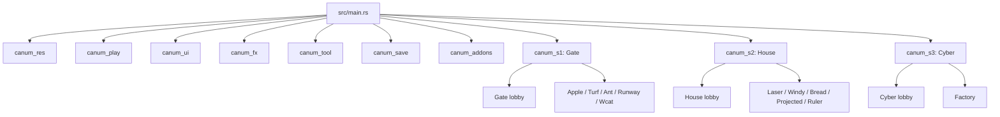
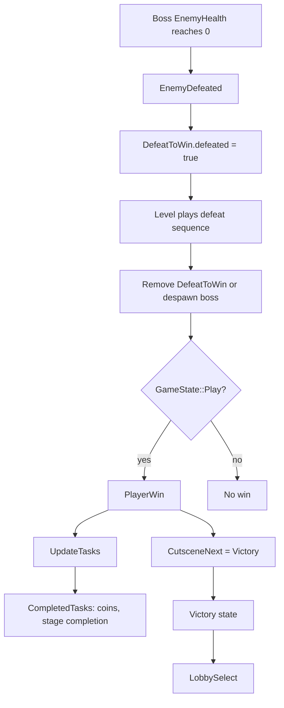

# Canum Level Coding Guide

> **Purpose.** This is the working handbook for implementing a level in a `canum_sN` stage crate. It
> describes the contracts, the tools exposed to stage crates, the current coding conventions, and the
> pitfalls that are easy to hit when adding a boss, a lobby, a shop, or a scripted reward state.
>
> **Precedence.** When examples disagree, newer code wins:
> **Stage 3 (Cyber) > Stage 2 (House) > Stage 1 (Gate)**.
> `canum_s1` and most of `canum_s2` are legacy or transitional. Use them to understand level
> structure, not to copy animation/session code.
>
> **Companion document.** `design-pattern.md` is the architecture reference. This file is narrower:
> it is the checklist and recipe book for writing a level that fits the project.
>
> **Toolchain assumed by this guide:** Rust edition 2024, Bevy 0.20, avian2d 0.8, and the public
> APIs of `canum_play` / `canum_fx` / `canum_ui` / `canum_tool` / `canum_res`.

---

## 0. Rules at a glance

These are the non-negotiable conventions for new level code.

1. A level is a `setup::Fight(String)` state. Enter it only with
   `commands.trigger(setup::StartSession { fight })`, never by writing `NextState<Fight>` directly.
2. Give each level one `Fight` constant and one `SystemSet`. Configure the set once with
   `in_state(...)`; do not put `.run_if(in_state(...))` on every system.
3. Use `canum_fx::session_observers!` for per-session observers and
   `canum_fx::wait_then_trigger!` for timed choreography. Do not hand-spawn `SessionOnly` observers.
4. Use `SpriteSheet`, `SpriteSheetQueue`, and `SpriteSheetPlayer` for new gameplay sprites.
   `canum_res::Animation` is for the player, backgrounds, engine effects, and legacy levels only.
5. Use `consts::damage::*` and `consts::order::*`; do not introduce raw damage/order numbers.
6. Use `enemy::movements::Displacement` with `quadratic_curve!` / `cubic_curve!` for scripted motion.
   Do not hand-roll fixed velocities for one-shot movement.
7. Boss AI goes through `BehaviorManager` + `Behavior` children. Every started behavior must eventually
   send `BehaveEnd`; every behavior that owns persistent children must clean them up on
   `BehaveIntervene`.
8. **Never declare `Res<player::RandomPlayer>` or `Res<player::PrimaryPlayer>` directly.** Use
   `Option<Res<...>>` or `If<Res<...>>`, and then still guard every `get(entity)` call. The resources
   can be absent, and `RandomPlayer` can point at an entity that no longer exists. This is explained
   in [3.4](#34-player-resources-and-the-no-resrandomplayer-rule).
9. Everything gameplay-related must be session-scoped. Use `SessionOnly`, `ChildSessionOnly`,
   `CutsceneDelete`, `CutsceneWait`, and `CutsceneNext` deliberately.
10. Normal wins go through `EnemyHealth` → `EnemyDefeated` → `DefeatToWin`. Do not call `PlayerWin`
    manually for a normal boss.

---

## 1. Mental model

### 1.1 The three layers

| Layer | What it is | Where it lives | Key identifier |
| --- | --- | --- | --- |
| Stage | Narrative/asset grouping with one hub lobby and its bosses | `canum_s1`, `canum_s2`, `canum_s3` | `CanumSNPlugin` |
| Level | One playable fight or hub, selected by a `Fight` state | one module in a stage crate | `Fight("Apple")`, `FACTORY_STATE` |
| Mechanics | Reusable ECS behavior: damage, movement, behaviors, projectiles, UI, FX | `canum_play`, `canum_fx`, `canum_ui`, `canum_tool`, `canum_res` | components/events/systems |

A stage crate does **not** own the player, damage, UI, or session lifecycle. It only adds level
plugins to the shared app. The shared plugin root is `canum_play::CanumPlayPlugin`; the app in
`src/main.rs` adds it before the stage plugins.



### 1.2 What a stage crate may depend on

Stage crates already list these dependencies (see any `canum_sN/Cargo.toml`):

- `bevy` 0.20, `avian2d` 0.8, `rand` 0.10
- `canum_play`, `canum_fx`, `canum_res`, `canum_save`, `canum_ui`, `canum_tool`
- `ron` + `serde` in `canum_s2` / `canum_s3` when the level parses custom config data

Stage crates do **not** depend on `canum_addons`. Stage-specific charms/effects belong in
`canum_addons/src/charms/sN.rs`; weapons belong in `canum_addons/src/weapons/`. They do not belong in
a level file. A level grants content by writing to `Save` (shop unlocks, reward cutscenes), and
`canum_addons` reacts to `StartSession*` phases.

This also means a stage crate cannot directly trigger `canum_addons` events such as
`GetAchievement`. If a level-specific achievement or effect is required, add the bridge in
`canum_addons` (for example an observer on an existing shared event) rather than adding
`canum_addons` as a stage-crate dependency.

---

## 2. Stage crate layout

### 2.1 The current layout

`canum_s3` is the reference:

```text
canum_s3/src/
├── lib.rs              # CanumS3Plugin: adds lobby + level plugins
├── lobby.rs            # Fight("Cyber") hub
└── factory.rs          # Fight("Factory"): state, SystemSet, boss marker
    └── factory/
        ├── entry.rs    # EntryPlugin: intro, arena, spawn boss, UI
        └── robot.rs    # RobotPlugin: BehaviorManager and behaviors
```

`canum_s3/src/lib.rs`:

```rust
mod factory;
mod lobby;

use canum_play::prelude::*;

pub struct CanumS3Plugin;

impl Plugin for CanumS3Plugin {
    fn build(&self, app: &mut App) {
        app.add_plugins((lobby::LobbyPlugin, factory::FactoryPlugin));
    }
}
```

Modules are private in Stage 3. That is fine for a self-contained stage. Older stages use
`pub mod`; only use `pub` if another crate genuinely needs the symbol.

### 2.2 Level module skeleton

A level module normally contains:

- the level `Fight` constant,
- the level `SystemSet`,
- the `Plugin` that registers child plugins and configures the set,
- level-wide constants (health, sizes, timing),
- the boss marker component (or minion markers).

`canum_s3/src/factory.rs` is the model:

```rust
mod entry;
mod robot;

use canum_play::prelude::*;

pub(super) struct FactoryPlugin;

pub static FACTORY_STATE: LazyLock<setup::Fight> =
    LazyLock::new(|| setup::Fight("Factory".to_owned()));

#[derive(Debug, Clone, Copy, PartialEq, Eq, Hash, SystemSet)]
pub struct FactorySystems;

impl Plugin for FactoryPlugin {
    fn build(&self, app: &mut App) {
        app.add_plugins((entry::EntryPlugin, robot::RobotPlugin));
        app.configure_sets(
            FixedPreUpdate,
            FactorySystems.run_if(in_state(FACTORY_STATE.clone())),
        );
        app.configure_sets(
            FixedUpdate,
            FactorySystems.run_if(in_state(FACTORY_STATE.clone())),
        );
    }
}
```

Rules:

- `Fight` is **not** `Copy`. Clone it into `in_state`, `OnEnter`, and `OnExit`.
- Configure the set in every schedule where level systems run. If a system is in `FixedPostUpdate`
  or `FixedLast`, configure `MyLevelSystems` there too.
- Child plugins are an organizational tool, not a requirement. A small level can put entry,
  behaviors, and defeat in one file; a large level should split them as `entry.rs`, `behaviors.rs`,
  `defeat.rs`, `background.rs`, `obstacles.rs`, `projectiles.rs`, etc.
- `OnEnter` systems are already state-specific. Do not wrap them in the level set.

### 2.3 Registering a new level

1. Add `canum_sN/src/my_level.rs` and any submodules.
2. Add `my_level::MyLevelPlugin` to the stage `lib.rs`.
3. Add the level to the stage lobby’s boss-panel index.
4. Add the level to `assets/values/<stage>.ron` (`boss` gains, stage locks if needed).
5. Add sprites/sounds/text/dialogue to the asset include chain.
6. Add a `SystemSet` and the entry/behaviors/defeat modules.
7. Run `cargo check` and play the level.

For a brand-new stage crate:

- add `canum_sN` to the root `Cargo.toml` dependencies,
- add `canum_sN::CanumSNPlugin` to `src/main.rs`,
- add `assets/values/<stage>.ron` to `assets/values/values.ron`,
- add `assets/sprites/<stage>/...` to `assets/sprites/sprites.json`,
- add `assets/sounds/<stage>/...` to `assets/sounds/sounds.json`,
- add `assets/text/en/<stage>/...` to `assets/text/en/en.json` (and the equivalent file for each
  other language),
- add stage add-ons under `canum_addons/src/charms/sN.rs` and register them in
  `canum_addons/src/charms.rs` if the stage grants new effects.

If the level parses `CONFIG.values.custom` into typed data, add `ron` and `serde` dependencies to the
stage crate (as `canum_s2` and `canum_s3` do).

---

## 3. Session lifecycle and shared state

### 3.1 State machine

The shared state machine is in `canum_play/src/setup.rs`.

| Item | Meaning |
| --- | --- |
| `GameState` | `Play` or `Cutscene` |
| `PlayState` | `Fighting`, `Lobby`, or `Shop` (while `GameState::Play`) |
| `Fight(String)` | The current level key |
| `FightTime` | Elapsed time in the current fight |
| `StartSession { fight }` | The only supported entry point into a level |
| `StartSessionFirst` | First setup phase, after player spawn |
| `StartSessionMiddle` | Second setup phase, after first-phase responses |
| `StartSessionAction` | Third phase, for spawning add-on entities |
| `StartSessionBaseUi` | Fourth phase, mandatory UI |
| `StartSessionAddedUi` | Fifth phase, optional-effect UI |
| `InitializationComplete` | True after all five phases |
| `in_stable_state(state)` | Run condition: initialization complete and state matches |

### 3.2 What `StartSession` does

`setup_session` is the only place that swaps a session. In order, it:

1. despawns all `SessionOnly` entities,
2. despawns the children of every `ChildSessionOnly` anchor,
3. resets the camera transform,
4. spawns the four `Boundaries` walls,
5. inserts `ScreenBounds`,
6. spawns the `Player` with `Animation`, `Weapons`, and `IntegerHealth`,
7. inserts `PrimaryPlayer`, `RandomPlayer`, `ProjectileBounds`,
8. resets `FightTime`,
9. sets `GameState::Play`, `PlayState::Fighting`, and `Fight(fight)`,
10. triggers `StartSessionFirst`.

The later phases are spread over about five frames. If a system must wait for all add-on and UI
setup, gate it with `in_stable_state(...)`. The lobby camera does this in
`canum_play/src/setup/lobby.rs`.

```rust
app.add_systems(
    FixedPostUpdate,
    camera_follow_player.run_if(in_stable_state(PlayState::Lobby)),
);
```

### 3.3 Session cleanup markers

| Marker | Removed when | Use for |
| --- | --- | --- |
| `SessionOnly` | Any new `StartSession` | All combat entities, background, music, observers, UI children, temporary effects |
| `ChildSessionOnly` | Any new `StartSession`, but only its children | Persistent UI anchors (used by `canum_ui/src/setup.rs`) |
| `CutsceneDelete` | Entering `GameState::Cutscene`, and also session change (it requires `SessionOnly`) | Lobby event observers and temporary lobby entities |
| `CutsceneWait` | When the entity despawns | Gate the next session until sounds/animations finish |
| `CutsceneNext` (resource) | Consumed once | The next `StartSession` to run after the cutscene |

Important consequences:

- `Friendly` requires `SessionOnly`; `Projectile` requires it too. Most combat entities are cleaned
  up automatically.
- Children of a `SessionOnly` entity are despawned with the parent. You do not need to add
  `SessionOnly` to every child, but it is harmless.
- `CutsceneWait` entities are **not** session-scoped. If one leaks, `CutsceneNext` never fires.
  Ensure the sound/effect you attached it to actually despawns.
- `CutsceneDelete` is what lobby observers use. It is both cutscene-deleted and session-deleted, so
  stale lobby handlers cannot react in the next level.

### 3.4 Player resources and the no-`Res<RandomPlayer>` rule

There are two player resources:

- `PrimaryPlayer(Entity)` — the controlled player. **Removed during `PlayerFail`** so control is
  disabled.
- `RandomPlayer(Entity)` — the boss targeting player. Re-selected about once per second. It is not
  removed on failure, but it can point at an entity that has been despawned, and the resource itself
  may be absent outside a session.

Therefore:

```rust
// BAD: panics if the resource is absent; the entity may also be despawned.
fn bad(player: Res<player::RandomPlayer>, q: Query<&GlobalTransform>) {
    let transform = q.get(player.0).unwrap();
}

// GOOD: absent resource skips the system; missing entity is handled.
fn good(
    player: Option<Res<player::RandomPlayer>>,
    q: Query<&GlobalTransform>,
) {
    let Some(player) = player else { return; };
    let Ok(transform) = q.get(player.0) else { return; };
    // ...
}

// GOOD when the system only needs to run if a player resource exists.
// If derefs to Res, Res to RandomPlayer, and RandomPlayer to Entity.
fn also_good(player: If<Res<player::RandomPlayer>>, q: Query<&GlobalTransform>) {
    let entity: Entity = ***player;
    let Ok(transform) = q.get(entity) else { return; };
    // ...
}
```

Use the same pattern for `PrimaryPlayer`:

```rust
fn aim_at_player(
    primary: Option<Res<player::PrimaryPlayer>>,
    q: Query<&GlobalTransform>,
) {
    let Some(primary) = primary else { return; };
    let Ok(transform) = q.get(primary.0) else { return; };
    // ...
}
```

Why this matters:

- Level `OnEnter` and `OnExit` systems can run outside the expected player lifetime.
- `Player
Fail` removes `PrimaryPlayer` and enters a cutscene while the old player entity still
  exists for a moment.
- `RandomPlayer` can lag behind a despawned entity.
- `Res<T>` is a hard requirement: if `T` is absent, the system panics before your code runs.

Also avoid using `Single<...With<Player>>` when the player might be absent or when multiple players
could exist. `Single` skips the system silently if the cardinality is not exactly one, which can hide
logic errors. Prefer `Query<...>` plus explicit `get`/`single` checks.

### 3.5 Other shared resources

| Resource | Lifetime | Use |
| --- | --- | --- |
| `Save` | App lifetime | Persistent progress. Always present. |
| `Lang` | App lifetime | Localized text. Always present. |
| `CONFIG` | App lifetime (static) | Read-only configuration. |
| `FightTime` | Reset each session | Intro timing when not using `wait_then_trigger!`. |
| `ScreenBounds(Rect)` | Session; lobby enlarges it | Player `MoveMeBack` bounds. |
| `ProjectileBounds(Rect)` | Session; lobby enlarges it | Projectile removal bounds. |
| `PlayerAveragePosition(Vec2)` | Updated each fixed frame | Behavior distance weights. |
| `PlayerAttackInfo.charge_ratio` | Reset each session | Boss reactions to charged weapons. |
| `AnyHits(bool)` | Reset for non-`_` fights | No-hit task tracking. |

### 3.6 What level code must not do

- Do not spawn the player, the session boundaries, weapons, or player health. `setup_session` owns
  those; a level only adds enemies, hazards, effects, and UI.
- Do not write `NextState<Fight>`, `NextState<GameState>`, or `NextState<PlayState>` directly. Use
  `StartSession`, `PureColorCutscene`, `EnterShop`, or the shared victory/failure flow.
- Do not mutate `PrimaryPlayer` or `RandomPlayer`. They are managed by the player plugin and the
  session setup.
- Do not call `UpdateTasks` more than once for the same fight from a normal boss kill. The normal
  `PlayerWin` path calls it; a reward state calls it manually only because it is an in-between state.
- Do not store gameplay state in a global resource without removing it in `OnExit`. Prefer
  `SessionOnly` entities, or follow the `OnEnter` insert / `OnExit` remove pattern used by Windy and
  Projected.
- Do not reuse a private helper type from another level crate. Levels in different stages are
  independent; duplicate small helpers or put truly shared mechanics in `canum_play`/`canum_fx`.

### 3.7 Player-facing tools

These are the player components/events most useful to level code:

| Tool | Use |
| --- | --- |
| `player::Player` | Marker for the player entity; query with `With<Player>`. |
| `player::PlayerShoot(f32)` | Facing angle in radians. Use `Vec2::from_angle(shoot.0)` to aim. |
| `GlobalTransform` / `LinearVelocity` | World position and current velocity of the player. |
| `player::PlayerMove { entity, rot, mult }` | Entity event to request movement; the player’s acceleration/friction still applies. |
| `player::PlayerStopMove { entity }` | Entity event to stop movement input. |
| `movements::StartDash { entity, base_velocity }` | Entity event to start a dash; `base_velocity` is multiplied by `Dash::max_speed`. |
| `player::attack::Attack { entity }` | Entity event that propagates down the player hierarchy to weapons. |
| `player::attack::AttackRelease { entity }` | Entity event that propagates attack release. |
| `controls::EmulateAttack { entity, kind }` | Scripted attack input; `EmulateAttackKind::{Begin, End}`. |
| `player::attack::Weapons(Vec<Option<Entity>>)` | The player’s weapon slot list. |
| `player::attack::PlayerAttackInfo.charge_ratio` | Shared 0–1 charge heuristic. |
| `player::ScreenBounds(Rect)` | `MoveMeBack` bounds; normally set by the session/lobby. |
| `projectile::ProjectileBounds(Rect)` | Out-of-bounds removal bounds. |

Level code rarely sends `PlayerMove` directly; scripted intros use `OverrideMainControls` and a
`Displacement` on the player instead. If you do send it, remember it is an `EntityEvent`:

```rust
commands.trigger(player::PlayerMove {
    entity: player_entity,
    rot: Vec2::Y.to_angle(),
    mult: 1.0,
});
```

`PlayerShoot` is the standard way for a boss to aim at the player’s facing direction; for aiming at
the player’s position, use `GlobalTransform`.

---

## 4. The minimal new level

### 4.1 `my_level.rs`

```rust
mod entry;
mod behaviors;
mod defeat;

use canum_play::prelude::*;

pub(super) struct MyLevelPlugin;

pub static MY_LEVEL_STATE: LazyLock<setup::Fight> =
    LazyLock::new(|| setup::Fight("MyLevel".to_owned()));

#[derive(Debug, Clone, Copy, PartialEq, Eq, Hash, SystemSet)]
pub struct MyLevelSystems;

impl Plugin for MyLevelPlugin {
    fn build(&self, app: &mut App) {
        app.add_plugins((
            entry::EntryPlugin,
            behaviors::BehaviorsPlugin,
            defeat::DefeatPlugin,
        ));
        app.configure_sets(
            FixedPreUpdate,
            MyLevelSystems.run_if(in_state(MY_LEVEL_STATE.clone())),
        );
        app.configure_sets(
            FixedUpdate,
            MyLevelSystems.run_if(in_state(MY_LEVEL_STATE.clone())),
        );
    }
}

pub const MY_BOSS_HEALTH: i32 = 3000;

#[derive(Component, Default)]
#[require(
    SpriteSheet::new("MyLevel_Boss"),
    canum_tool::animation::SpriteSheetQueue::new_with("MyLevel_Boss"),
    Transform::from_translation(vec3(0.0, 0.0, 14.37)),
    RigidBody::Dynamic,
    Collider::rectangle(48.0, 48.0),
    Mass(8.0),
    AngularInertia(1.0),
    LockedAxes::ROTATION_LOCKED,
    Restitution::new(0.5),
    health::Friendly(false),
    health::ContactDamage {
        value: consts::damage::ONE_MID,
        projectile: false,
        order: consts::order::ENEMY_BOSS,
    },
    movements::SpeedDecay(0.5),
    enemy::health::EnemyHealth::new(MY_BOSS_HEALTH),
    enemy::health::DamageSound::new("Wcat_Damage"),
    player::victory::DefeatToWin::default(),
    canum_fx::emphasis::LeaveTrail::new(0.1, 0.12),
    defeat::MyBossDefeat,
)]
pub struct MyBoss;
```

The `MyBossDefeat` marker is a level-local component whose only job is to attach the defeat observer.
Put its definition in `defeat.rs`:

```rust
#[derive(Component, Default)]
pub struct MyBossDefeat;
```

### 4.2 `entry.rs`

```rust
use super::*;

pub(super) struct EntryPlugin;

impl Plugin for EntryPlugin {
    fn build(&self, app: &mut App) {
        app.add_systems(OnEnter(MY_LEVEL_STATE.clone()), setup_my_level);
    }
}

#[derive(Event, Default)]
struct MyLevelInit;

#[derive(Event, Default)]
struct MyLevelStart;

#[derive(Event, Default)]
struct MyLevelSpawnHealthBar;

fn setup_my_level(
    mut commands: Commands,
    mut window_title: ResMut<canum_res::window::WindowTitle>,
    lang: Res<Lang>,
) {
    window_title.0 = lang.get("MyLevel_WindowTitle").to_owned();

    commands.spawn((
        canum_res::background::Background::new(CONFIG.display.screen_size),
        Animation::new("MyLevel_Back", CONFIG.display.screen_size)
            .with_color(Color::default().with_alpha(0.8)),
    ));

    canum_fx::session_observers!(
        commands,
        spawn_boss,
        spawn_title,
        spawn_health_bar,
    );
    canum_fx::wait_then_trigger!(use commands, MyLevelInit, 0.5);
    canum_fx::wait_then_trigger!(use commands, MyLevelStart, 2.0);
    canum_fx::wait_then_trigger!(use commands, MyLevelSpawnHealthBar, 2.1);
}

fn spawn_boss(_event: On<MyLevelStart>, mut commands: Commands) {
    let boss = commands.spawn((MyBoss, behaviors::MyBehaviors)).id();
    commands.spawn((
        ChildOf(boss),
        enemy::health::EnemySensor,
        Collider::rectangle(60.0, 60.0),
    ));
    commands.spawn((Music, Sound::new("MyLevel_Bgm")));
}

fn spawn_title(
    _event: On<MyLevelInit>,
    lang: Res<Lang>,
    fonts: Res<canum_ui::Fonts>,
    bottom_left: Single<Entity, With<canum_ui::BottomLeft>>,
    mut commands: Commands,
) {
    commands.spawn((
        ChildOf(bottom_left.entity()),
        canum_ui::text::popup_title(
            fonts.title.clone(),
            lang.get("MyLevel_BossTitle"),
            Duration::from_secs_f32(1.5),
        ),
    ));
}

fn spawn_health_bar(
    _event: On<MyLevelSpawnHealthBar>,
    save: Res<Save>,
    bottom_center: Single<Entity, With<canum_ui::BottomCenter>>,
    boss: Single<Entity, With<MyBoss>>,
    mut commands: Commands,
) {
    if !save.progress.selected_effects.contains("ShowHealth") {
        return;
    }
    commands.spawn((
        ChildOf(bottom_center.entity()),
        canum_ui::bar::AssociatedBoss(boss.entity()),
        canum_ui::bar::health_bar(
            Color::Srgba(Srgba::hex("#2eb6ff").unwrap()),
            Color::Srgba(Srgba::hex("#2d065a").unwrap()),
            canum_ui::bar::HealthBar {
                total: MY_BOSS_HEALTH as f32,
                current: MY_BOSS_HEALTH as f32,
                ..default()
            },
        ),
    ));
}
```

Notes:

- `spawn_health_bar` **must** be listed in `session_observers!`. A `wait_then_trigger!` only emits
  the event; it does not register the handler. Factory registers `spawn_robot_health_bar` this way.
  When copying, keep every event handler registered.
- `Animation` is acceptable for `canum_res::background::Background`. New boss/minion/hazard sprites
  should use `SpriteSheet`.
- `Music` and `Background` are automatically `SessionOnly` by `setup::SetupPlugin`.
- The window title key must exist in the stage text file. Missing text renders as `<MISSING TEXT>`.
- If the intro should freeze the player, spawn `(SessionOnly, controls::OverrideMainControls)` and
  remove/despawn it on `MyLevelStart`. `LobbyQuit` still fires while controls are overridden.
- Use `lang.get_or_empty` for optional text; `lang.get` is for text that must exist.

### 4.3 `behaviors.rs`

```rust
use super::*;
use enemy::behavior::*;

pub(super) struct BehaviorsPlugin;

impl Plugin for BehaviorsPlugin {
    fn build(&self, app: &mut App) {
        app.world_mut()
            .register_component_hooks::<MyBehaviors>()
            .on_add(my_behaviors_hook);
    }
}

#[derive(Component, Default)]
#[require(BehaviorManager::new())]
pub struct MyBehaviors;

fn my_behaviors_hook(
    mut world: DeferredWorld,
    HookContext { entity, .. }: HookContext,
) {
    world
        .commands()
        .spawn((ChildOf(entity), Slam::default()))
        .observe(slam_start)
        .observe(slam_end)
        .observe(intervene_slam);
}

#[derive(Component, Default)]
#[require(
    Behavior::new("MyLevel_Slam", 1.0, ["Main", "Slam"]),
    BaseByDistance::new(180.0, 80.0),
)]
struct Slam {
    target: Option<Entity>,
    movement: Option<Entity>,
    active: bool,
}

fn slam_start(
    event: On<BehaveStart>,
    mut q_slam: Query<&mut Slam>,
    mut commands: Commands,
) {
    let Ok(mut slam) = q_slam.get_mut(event.entity) else { return; };
    slam.target = Some(event.target);
    slam.active = true;

    slam.movement = Some(
        commands
            .spawn((
                ChildOf(event.target),
                enemy::movements::Displacement {
                    curve: canum_fx::quadratic_curve!(1.0, 0.2),
                    displace: vec2(0.0, -100.0),
                    duration: Duration::from_secs_f32(0.35),
                    notify: Some(event.entity),
                },
            ))
            .id(),
    );
    commands.trigger(canum_tool::animation::SpriteSheetQueueUpdate::new(
        event.target,
        10,
        "MyLevel_Slam",
    ));
    commands.spawn(Sound::new("MyLevel_Slam"));
}

fn slam_end(
    event: On<enemy::movements::DisplacementComplete>,
    mut q_slam: Query<&mut Slam>,
    mut commands: Commands,
) {
    let Ok(mut slam) = q_slam.get_mut(event.entity) else { return; };
    if !slam.active {
        return;
    }
    slam.active = false;

    if let Some(movement) = slam.movement.take() {
        commands.entity(movement).try_despawn();
    }
    if let Some(target) = slam.target.take() {
        commands.trigger(canum_tool::animation::SpriteSheetQueueUpdate::new(
            target,
            10,
            "MyLevel_Slam",
        ).pop());
    }
    commands.trigger(BehaveEnd {
        entity: event.entity,
        cooldown: Duration::from_secs_f32(rand_normal(0.8, 0.1)),
        occupies: occupies![
            ("Slam", rand_normal(2.5, 0.3)),
            ("Main", rand_normal(0.4, 0.1).clamp(0.1, 1.0))
        ],
    });
}

fn intervene_slam(
    event: On<BehaveIntervene>,
    mut q_slam: Query<&mut Slam>,
    mut commands: Commands,
) {
    let Ok(mut slam) = q_slam.get_mut(event.entity) else { return; };
    slam.active = false;
    slam.target = None;
    if let Some(movement) = slam.movement.take() {
        commands.entity(movement).try_despawn();
    }
}
```

This is deliberately explicit: a behavior owns its state, must end on every path, and must clean up
persistent children when intervened. See [7](#7-the-behavior-system) for the full contract.

### 4.4 `defeat.rs`

```rust
use super::*;

pub(super) struct DefeatPlugin;

impl Plugin for DefeatPlugin {
    fn build(&self, app: &mut App) {
        app.world_mut()
            .register_component_hooks::<MyBossDefeat>()
            .on_add(|mut world, HookContext { entity, .. }| {
                world.commands().entity(entity).observe(on_defeat);
            });
    }
}

fn on_defeat(
    event: On<enemy::health::EnemyDefeated>,
    mut commands: Commands,
    mut q_queue: Query<&mut canum_tool::animation::SpriteSheetQueue>,
    q_music: Query<Entity, With<Music>>,
) {
    if let Ok(mut queue) = q_queue.get_mut(event.entity) {
        queue.push(10, "MyLevel_Defeat");
    }
    commands.spawn((
        ChildOf(event.entity),
        canum_fx::splash::Splash {
            color: Color::linear_rgba(0.8, 0.2, 0.2, 0.5),
            duration: Duration::from_secs_f32(0.4),
            number: 30,
        },
    ));
    commands.spawn((
        ChildOf(event.entity),
        canum_res::sound::Sound::new("MyLevel_Defeat"),
    ));
    for music in q_music.iter() {
        commands.entity(music).insert(canum_res::sound::FadeOut);
    }

    // Give the animation a moment, then remove the win marker.
    canum_fx::wait_then_trigger!(use commands, MyLevelRemoveDefeatToWin, 1.5);
}

#[derive(Event, Default)]
struct MyLevelRemoveDefeatToWin;

fn remove_defeat_to_win(
    _event: On<MyLevelRemoveDefeatToWin>,
    mut commands: Commands,
    boss: Single<Entity, With<MyBoss>>,
) {
    commands.entity(boss.entity()).despawn();
}
```

`MyLevelRemoveDefeatToWin` is a private event. If you use `wait_then_trigger!(use commands, ...)`
inside a function, the generated `Waiting` type is local to that block, so the same macro can be
used multiple times in one function.

The win happens when `DefeatToWin` is removed while `GameState::Play`. The shared hook checks
`defeated == true` and then triggers `PlayerWin`. Do not manually trigger `PlayerWin` for a normal
boss.

---

## 5. Entry choreography in detail

### 5.1 What every fight entry should do

A normal boss entry should:

1. Set `WindowTitle`.
2. Spawn a background (`canum_res::background::Background` + `Animation`), unless the level uses
   `PureColor` or a custom background.
3. Spawn session-scoped observers for the intro events.
4. Spawn the boss marker and its `BehaviorManager`.
5. Spawn an `EnemySensor` child with a larger hitbox if the physical collider is small.
6. Spawn the boss health bar, only when `ShowHealth` is selected.
7. Spawn `Music` at the appropriate moment.
8. Spawn the boss title popup.
9. Optionally spawn dialogue with `Dialogue::from_config` and a `first_time` check.

### 5.2 The current macro pattern

`canum_s3/src/factory/entry.rs`:

```rust
fn setup_factory(
    mut commands: Commands,
    mut window_title: ResMut<canum_res::window::WindowTitle>,
    lang: Res<Lang>,
) {
    window_title.0 = lang.get("Factory_WindowTitle").to_owned();

    canum_fx::session_observers!(
        commands,
        spawn_box,
        spawn_title,
        spawn_robot,
        spawn_robot_health_bar
    );
    canum_fx::wait_then_trigger!(use commands, FactoryInit, 0.5);
    canum_fx::wait_then_trigger!(use commands, FactoryStart, 2.0);
    canum_fx::wait_then_trigger!(use commands, FactorySpawnHealthBar, 2.1);
}
```

`session_observers!` spawns one `SessionOnly` entity per observer. `wait_then_trigger!` spawns a
`WaitInterval` entity, then triggers the event type at the given time. The `use commands` form is the
current standard; the non-`use` form exists for older code.

### 5.3 Dialogue intro

`canum_s2/src/ruler/entry.rs` is the reference for a scripted intro:

```rust
fn ruler_spawn_dialogue(
    _event: On<RulerSpawnDialogue>,
    mut commands: Commands,
    bottom_center: Single<Entity, With<canum_ui::BottomCenter>>,
    mut save: ResMut<Save>,
    lang: Res<Lang>,
) {
    if save.progress.first_time("Ruler_Prefight") {
        commands.spawn((
            ChildOf(bottom_center.entity()),
            canum_ui::dialogue::Dialogue::from_config("Ruler_Prefight", lang),
        ));
    } else {
        commands.trigger(RulerSpawnTitle::Normal);
    }
}
```

- `Dialogue::from_config(name: &'static str, lang: impl AsRef<Lang>)` returns a `Dialogue`
  component. Spawn it as a child of an anchor.
- `Dialogue` requires `OverrideMainControls`, so the player cannot move or attack while it is open.
- When the dialogue completes, the shared code triggers `canum_ui::dialogue::DialogueComplete`.
  Observe it to continue the intro.
- Use `Progress::first_time("...")` to show a pre-fight dialogue only once. The flag is saved.
- Dialogue sections come from `CONFIG.assets.dialogue`; each section key is a localization key. The
  localized value format is `icon_image:title:text`, with `</br>` separating multiple text pages.

### 5.4 Title popup

`canum_ui::text::popup_title(font, content, fade)` returns a UI bundle. Spawn it as a child of
`canum_ui::BottomLeft` (boss titles) or another anchor:

```rust
commands.spawn((
    ChildOf(bottom_left.entity()),
    canum_ui::text::popup_title(
        fonts.title.clone(),
        lang.get("MyLevel_BossTitle"),
        Duration::from_secs_f32(1.5),
    ),
));
```

The text supports two prefixes:

- `+` on a line makes that line larger (50 px instead of 30 px).
- `/` on a line adds a 300 ms delay before that line.

### 5.5 Health bar

```rust
if save.progress.selected_effects.contains("ShowHealth") {
    commands.spawn((
        ChildOf(bottom_center.entity()),
        canum_ui::bar::AssociatedBoss(boss_entity),
        canum_ui::bar::health_bar(
            foreground_color,
            background_color,
            canum_ui::bar::HealthBar {
                total: MY_BOSS_HEALTH as f32,
                current: MY_BOSS_HEALTH as f32,
                ..default()
            },
        ),
    ));
}
```

- `AssociatedBoss` automatically reads `EnemyHealth` and drains the linger bar after damage.
- The bar despawns itself when the boss entity no longer has `EnemyHealth` or is despawned.
- For a timer bar (no `EnemyHealth`), use `health_bar(...)` without `AssociatedBoss` and update
  `HealthBar.current` yourself. `canum_s1/src/turf.rs` does this for its 90-second survival timer.

### 5.6 Music and audio

```rust
commands.spawn((Music, Sound::new("MyLevel_Bgm")));
commands.spawn(Sound::new("MyLevel_Hit"));
```

- `Music` is a single-track marker. Adding a new `Music` fades out the previous one.
- `Music` and `Background` are automatically `SessionOnly`.
- `Sound` plays once and despawns unless the configured sound has a `loop_point`, in which case it
  loops.
- `FadeIn` and `FadeOut` are components from `canum_res::sound`; add them to fade.
- A sound spawned as `ChildOf(entity)` dies with that entity. For sounds that must track a projectile
  or temporary entity, use `canum_fx::util::DespawnCheck::new(target)`.

---

## 6. Entity recipes

### 6.1 Required components are defaults, not restrictions

Bevy’s `#[require(...)]` supplies missing components. If you explicitly include a component in the
spawn bundle, your value wins. For example, a boss marker may require
`ContactDamage { value: ONE_MID, ... }`, and a specific boss can override it with a different value.

If you add **both** `SpriteSheet` and `canum_res::Animation` to the same entity, both systems will
try to drive `Sprite`. Do not mix them.

Bevy 0.20 child syntax used throughout the codebase:

```rust
// Spawn a parent and its children in one bundle.
commands.spawn((MyBoss, children![MySensor, MyBehavior]));

// Attach an already-spawned child.
commands.spawn((ChildOf(parent), MySensor, Collider::circle(10.0)));
```

Use `ChildOf` when the child must inherit the parent’s transform (hitboxes, behavior managers,
visual effects). Use `canum_fx::transform::Follow` when the entity must stay in world space while
tracking a target.

### 6.2 Boss

The current boss recipe is `canum_s3/src/factory.rs`:

```rust
#[derive(Component, Default)]
#[require(
    SpriteSheet::new("Factory_Robot"),
    canum_tool::animation::SpriteSheetQueue::new_with("Factory_Robot"),
    Transform::from_translation(Vec3::new(0.0, 0.0, 14.37)),
    RigidBody::Dynamic,
    Collider::rectangle(32.0, 32.0),
    Mass(9.0),
    AngularInertia(1.0),
    LockedAxes::ROTATION_LOCKED,
    Restitution::new(0.6),
    health::Friendly(false),
    health::ContactDamage {
        value: consts::damage::ONE_MID,
        projectile: false,
        order: consts::order::ENEMY_BOSS,
    },
    movements::SpeedDecay(0.3),
    enemy::health::EnemyHealth::new(ROBOT_HEALTH),
    enemy::health::DamageSound::new("Wcat_Damage"),
    canum_fx::emphasis::LeaveTrail::new(0.1, 0.12),
)]
pub struct RobotBoss;
```

Use this as the default. Add or remove:

- `SpriteSheetPlayer` if the base sheet is animated; without it, the sheet is static.
- `LockedAxes::ROTATION_LOCKED` for upright bosses; omit for spinning bosses.
- `RigidBody::Kinematic` if the boss should not be pushed by collisions (Ruler uses this).
- `projectile::NoCollideBoundary` if the boss is allowed to leave the arena bounds or is moved by
  scripted effects that would otherwise hit the walls.
- `player::MoveMeBack` only if the boss should be teleported back inside `ScreenBounds`; this is
  normally for the player, not bosses.
- `canum_fx::visual::Shadow` as a **child**, never on the main sprite entity. `Shadow` requires
  `canum_res::Animation` and rewrites it to the “Shadow” sheet.
- `SpeedShrink` / `AutoFlip` only on entities that use `canum_res::Animation`; they do not work with
  `SpriteSheet`.

### 6.3 Enemy sensor

The physical collider and the damageable hitbox are often different. Add an `EnemySensor` child:

```rust
let boss = commands.spawn((MyBoss, MyBehaviors)).id();
commands.spawn((
    ChildOf(boss),
    enemy::health::EnemySensor,
    Collider::rectangle(60.0, 60.0),
));
```

- `EnemySensor` is a `Sensor` with `Friendly(false)`; it forwards `Damage` to its parent.
- The sensor itself does not have `EnemyHealth`; the parent does.
- Use a larger sensor for forgiving hitboxes, or a smaller one for precise weak points.
- The sensor's `Transform` is local to the boss. Offset it with `Transform::from_translation(...)`.
- Do not add `EnemySensor` to a child that also has `ContactDamage` unless you intend it; contact
  damage climbs `ChildOf` to the root and uses `CollidingEntities`.

### 6.4 Minion / wave enemy

`canum_s2/src/projected/enemies.rs` defines the shared minion bundle:

```rust
#[derive(Component, Default)]
#[require(
    SessionOnly,
    Animation,
    RigidBody::Dynamic,
    Collider,
    Mass(3.0),
    LockedAxes::ROTATION_LOCKED,
    Restitution::new(0.2),
    health::Friendly(false),
    health::ContactDamage {
        value: 120,
        projectile: false,
        order: consts::order::ENEMY_MINION,
    },
    movements::SpeedDecay(0.4),
    movements::ForcedVelocity,
    enemy::health::EnemyHealth,
    enemy::health::DamageSound::new("Projected_ShadowHit"),
    projectile::NoCollideBoundary,
)]
pub struct ProjectedEnemy;
```

For a new Stage 3-style minion, replace `Animation` with `SpriteSheet` + `SpriteSheetPlayer` and use
`consts::damage::*` values:

```rust
#[derive(Component, Default)]
#[require(
    SessionOnly,
    SpriteSheet::new("MyLevel_Minion"),
    canum_tool::animation::SpriteSheetPlayer,
    RigidBody::Dynamic,
    Collider::circle(12.0),
    Mass(2.0),
    LockedAxes::ROTATION_LOCKED,
    Restitution::new(0.2),
    health::Friendly(false),
    health::ContactDamage {
        value: consts::damage::ONE_WEAK,
        projectile: false,
        order: consts::order::ENEMY_MINION,
    },
    movements::SpeedDecay(0.4),
    movements::ForcedVelocity,
    enemy::health::EnemyHealth::new(120),
    enemy::health::DamageSound::new("MyLevel_MinionHit"),
    projectile::NoCollideBoundary,
)]
pub struct MyMinion;
```

`Minion` from `canum_play::enemy::attack` is an Animation-bound convenience bundle. It always uses
`Animation` and a fixed contact-damage order. Prefer composing the required components yourself for
new sprite-sheet content.

### 6.5 Projectiles

A current-style enemy projectile:

```rust
#[derive(Component, Default)]
#[require(
    projectile::Projectile,
    SpriteSheet::new("MyLevel_Bullet"),
    canum_tool::animation::SpriteSheetPlayer,
    Collider::circle(6.0),
    Mass(0.2),
    LinearVelocity,
    health::Friendly(false),
    health::ContactDamage {
        value: consts::damage::ONE_WEAK,
        projectile: true,
        order: consts::order::ENEMY_PROJ,
    },
)]
pub struct MyBullet;

fn shoot(commands: &mut Commands, position: Vec2, direction: Vec2) {
    commands.spawn((
        MyBullet,
        Transform::from_translation(position.extend(4.0)),
        LinearVelocity(direction * 300.0),
    ));
}
```

Facts:

- `Projectile` already requires `SessionOnly`, `RemoveOutOfBounds`, `Transform`, `Visibility`,
  `RigidBody::Dynamic`, `Collider`, `NoCollideBoundary`, and `Friendly`.
- `ContactDamage { projectile: true, .. }` inserts `ProjectileContacted`, which prevents the same
  projectile from hitting the same target twice.
- `Projectile` despawns itself one fixed frame after any collision, unless `no_dispose` is set.
- `Projectile { no_dispose: true }` (or `.no_dispose()`) is for beams/sensors that should persist.
- `NoDisposeProjectile` on the *other* entity prevents a projectile from being disposed by that
  collision; it is used for beams and persistent sensors.
- `RemoveOutOfBounds` uses `ProjectileBounds`. Scale it with `distance_scale`.
- `NoCollideBoundary` is required by `Projectile`; remove it after spawn if the projectile should
  collide with arena boundaries.

`EnemyProjectile` and `PlayerProjectile` are Animation-bound convenience bundles:

- `EnemyProjectile` requires `Projectile`, `Friendly(false)`,
  `ContactDamage { value: 100, projectile: true, order: ENEMY_PROJ }`, and **`Animation`**.
- `PlayerProjectile` requires `Projectile`, `Friendly(true)`, `ContactDamage` (default 0, overridden
  by the weapon), and **`Animation`**.

Do not use these for new `SpriteSheet` content; they force `Animation` onto the entity and fight with
the sprite-sheet renderer. They remain valid for old levels and the existing weapon code.

For a non-projectile projectile-like hazard (saw, spinning blade, conveyor), use a normal entity with
`SpriteSheet`, `Collider`, `ContactDamage { projectile: false }`, and
`projectile::RemoveOutOfBounds` if it should clean up off-screen. `canum_s3` does this for `RobotSaw`
and `Conveyor`.

### 6.6 Obstacles and collision modifiers

| Tool | Use |
| --- | --- |
| `obstacle::OnewayCollision(Dir2)` | One-way platform/wall; only one relative velocity direction collides. |
| `obstacle::BumpAway { direction, strength }` | Push colliding entities away; used for screen edges. |
| `health::CollidePlayerOnly` | Only the player collides with this collider/sensor. |
| `health::DisableOpposingCollision` | Temporarily disable opposite-faction collision. |
| `health::AlwaysCollide(BTreeSet<Entity>)` | Force collisions with specific entities despite faction rules. |
| `health::Friendly(bool)` | Faction marker; same faction does not collide. |
| `projectile::NoCollideBoundary` | Skip arena boundary collisions. |

The Factory arena box is the reference for a friendly pusher:

```rust
commands.spawn((
    FactoryBox { start_scaling: true },
    SpriteSheet::new("Factory_Box"),
    Transform::from_scale(vec3(15.0, 15.0, 0.0)),
    RigidBody::Dynamic,
    collider,
    Mass(2.0),
    AngularInertia(1.0),
    Friction::new(0.3),
    Restitution {
        coefficient: 0.05,
        combine_rule: CoefficientCombine::Min,
    },
    health::Friendly::FRIENDLY,
    health::DisableOpposingCollision,
    health::AlwaysCollide(players),
    movements::SpeedDecay(0.008),
));
```

The box is friendly, so it normally would not collide with the player. `AlwaysCollide(players)`
forces the collision, and `DisableOpposingCollision` prevents it from colliding with enemies.

The Runway screen edge is the reference for a bumper:

```rust
commands.spawn((
    Transform::from_translation(vec3(0.0, half_height, 0.0)),
    Sensor,
    health::CollidePlayerOnly,
    Collider::rectangle(screen_width, 10.0),
    health::ContactDamage {
        value: 1000,
        order: consts::order::HEALTH_INVINC - 1,
        projectile: false,
    },
    obstacle::BumpAway {
        direction: Dir2::from_xy_unchecked(0.0, -1.0),
        strength: 30.0,
    },
));
```

The damage order is below `HEALTH_INVINC`. While the player has the invincibility shield (220), the
damage is absorbed and the `BumpAway` is what the player feels. If the player is not currently
invincible, the bumper can still deal its damage; Runway uses this to avoid chain-hits while still
pushing the player. If you want the bumper to always hurt, use an order above `HEALTH_INVINC`.

### 6.7 Damage and health

The damage chain:

```text
Collision / custom code
        │
        ▼
Damage { entity, value, order }     (EntityEvent)
        │
        ├── IntegerHealth  (player) ──► ActuallyHit / PlayerFail
        └── EnemyHealth    (enemy)  ──► EnemyDefeated
                                           │
                                           ▼
                                   DefeatToWin.defeated = true
```

#### `Damage`

```rust
commands.trigger(health::Damage {
    entity: target,
    value: consts::damage::ONE_MID,
    order: consts::order::PLAYER_PROJ,
});
```

The receiver decides what to do. `EnemyHealth` subtracts; `IntegerHealth` converts to 1–3 pips.

#### Enemy health

- `EnemyHealth::new(value)` or `EnemyHealth { value }`.
- On reaching zero it sets `value = i32::MIN` to prevent duplicate death events and triggers
  `EnemyDefeated { entity }`.
- `DamageSound::new("Name")` plays a throttled sound; it manages a child sound entity.
- `EnemySensor` forwards `Damage` from a child hitbox to the parent.

#### Player health

- The player gets `IntegerHealth::default()` in `setup_session` (6 pips).
- `IntegerHealth` has `invinc_order` (default `HEALTH_INVINC`) and `invinc_time` (1 second).
- On an actual hit it triggers `ActuallyHit`, spawns splash/sound, and adds an `InvincibilityTimer`.
- At zero it triggers `PlayerFail`.
- Level code should not spawn a second `IntegerHealth` on the player.

#### Shields and order

- `Shields(BTreeMap<u8, i32>)` absorbs damage only from shields with key **greater than** the damage
  order.
- `InvincibilityTimer::new(seconds, order)` adds a `i32::MAX` shield while active.
- Use `consts::order::*`; the important values are:
  - `ENEMY_PROJ = 50`
  - `ENEMY_MINION = 110`
  - `ENEMY_BOSS = 120`
  - `PLAYER_PROJ = 50`, `PLAYER_PROJ_WEAK = 40`, `PLAYER_PROJ_STRONG = 60`
  - `EXOSKELETON = 201`
  - `HEALTH_INVINC = 220`
  - `DASH_INVINC = 230`

#### Contact damage

`ContactDamage { value, projectile, order }` deals damage on collision with an opposite-faction
target. It requires `Friendly`, `CollidingEntities`, and `ContactDamageModifier`.

- Use `projectile: true` for projectiles and any entity that should not multi-hit the same target.
- The collision code climbs `ChildOf` to the root and checks faction before triggering `Damage`.
- `ContactDamageModifier` can add/multiply the value before the event; use it when a global buff or
  debuff should affect a hazard without rewriting its component.

#### Win marker

`player::victory::DefeatToWin { defeated }` is a component on the boss (or on a win-marker entity).
`EnemyDefeated` sets `defeated = true` if the entity has it. The win fires when the component is
**removed** while `GameState::Play` and `defeated == true`. Setting `defeated = true` alone does
nothing; you must remove the component or despawn the entity.

---

## 7. The behavior system

### 7.1 Entity structure

```text
Boss entity
├── SpriteSheet / SpriteSheetQueue
├── EnemyHealth / DamageSound / DefeatToWin
├── EnemySensor child
└── BehaviorManager (on the boss, or on a child of the boss)
    ├── Behavior A child
    ├── Behavior B child
    └── Behavior C child
```

- `BehaviorManager` may be on the boss entity itself (Factory does this) or on a child of the boss
  (Apple/Wcat/Ruler do this). If it has a `ChildOf`, its `target` defaults to the parent boss; if it
  has no parent, `target` defaults to the manager entity itself.
- Each behavior is a **child** of the manager with `Behavior` and `Weight`.
- A behavior without a `BehaviorManager` parent will warn and never be selected.
- A behavior manager without behavior children does nothing.

### 7.2 Core types

| Type | Meaning |
| --- | --- |
| `BehaviorManager` | Parent marker; `target: Option<Entity>`, `disabled: bool`. |
| `BehaviorManagerInfo` | Runtime state: name map, occupied resources, running set, cooldown, queue. |
| `Behavior` | Definition: `name`, `occupies`, `default_weight`, optional `cooldown`. |
| `Weight` | Per-frame weight: `predetermined * base * multiplier`. |
| `BehaveStart` | Sent to a behavior when selected. Carries `target` and optional `caller`. |
| `BehaveEnd` | Sent by the behavior to end itself. Carries extra `cooldown` and `occupies`. |
| `BehaveQueue` | Ask the manager to queue a sibling behavior by name. |
| `BehaveIntervene` | Force a running behavior to stop; auto-propagates. |
| `BehaviorProcess` | `Init` → `Calc` → `Trigger` schedule for weights/selection. |

### 7.3 Lifecycle

1. `update_manager_info` collects child behaviors into a name map.
2. `init_behavior_weights` resets `predetermined` to `Behavior::default_weight`, `base = 1`,
   `multiplier = 1`.
3. Weight-modifier systems run in `BehaviorProcess::Calc`.
4. `select_behavior` filters out behaviors whose resources are occupied or that are already running,
   then chooses by weight. Queued behaviors run first and ignore resource checks.
5. `start_behavior` marks resources occupied for a very long timer, adds the behavior to `running`,
   applies the behavior’s own cooldown, and sends `BehaveStart`.
6. The behavior does its work and eventually sends `BehaveEnd`. `end_behavior` releases its declared
   resources, installs the returned occupancy timers, removes it from `running`, and adds the
   returned cooldown to the manager cooldown.

### 7.4 Defining a behavior

```rust
#[derive(Component, Default)]
#[require(
    Behavior::new("MyLevel_Attack", 1.0, ["Main", "Attack"]),
    BaseByDistance::new(250.0, 80.0),
)]
struct Attack {
    target: Option<Entity>,
}
```

`Behavior::new(name, default_weight, occupies)`:

- `name` is local to the manager. Use a level-prefixed name to avoid collisions.
- `default_weight` is the base probability weight. `0.0` means “never auto-select”; use that for
  behaviors that are only triggered through `BehaveQueue`.
- `occupies` are resource names. A behavior cannot start while any of its resources are occupied.

`Behavior::new_with_cooldown(...)` or `.with_cooldown(Duration)` sets a per-behavior cooldown after
it starts. `BehaveEnd.cooldown` is an additional global manager cooldown after it ends.

### 7.5 Starting and ending work

```rust
fn attack_start(
    event: On<BehaveStart>,
    mut q_attack: Query<&mut Attack>,
    mut commands: Commands,
) {
    let Ok(mut attack) = q_attack.get_mut(event.entity) else { return; };
    attack.target = Some(event.target);

    // Spawn children on the boss, not on the behavior.
    commands.spawn((
        ChildOf(event.target),
        enemy::movements::Displacement {
            curve: canum_fx::quadratic_curve!(1.0, 0.2),
            displace: vec2(80.0, 0.0),
            duration: Duration::from_secs_f32(0.3),
            notify: Some(event.entity),
        },
    ));
    commands.spawn(Sound::new("MyLevel_Attack"));
}

fn attack_finish(
    event: On<enemy::movements::DisplacementComplete>,
    mut q_attack: Query<&mut Attack>,
    mut commands: Commands,
) {
    let Ok(mut attack) = q_attack.get_mut(event.entity) else { return; };
    let Some(target) = attack.target.take() else { return; };

    commands.trigger(canum_tool::animation::SpriteSheetQueueUpdate::new(
        target,
        10,
        "MyLevel_Attack",
    ).pop());
    commands.trigger(BehaveEnd {
        entity: event.entity,
        cooldown: Duration::from_secs_f32(rand_normal(0.8, 0.1)),
        occupies: occupies![
            ("Attack", rand_normal(3.0, 0.4)),
            ("Main", rand_normal(0.5, 0.2))
        ],
    });
}
```

Rules:

- `event.target` is the boss/target entity; `event.entity` is the behavior entity.
- Spawn movement/effects as children of `event.target`.
- Set `Displacement.notify = Some(event.entity)` so the behavior receives
  `DisplacementComplete`.
- Send `BehaveEnd` with `entity: event.entity`.
- `occupies!` takes `(resource, seconds)` pairs. Use `occupies![]` for no occupancy.
- If the behavior owns a persistent child (a saw, a laser, a spawned hazard), track its entity and
  despawn it on completion and on `BehaveIntervene`.

### 7.6 Weight modifiers

| Modifier | Effect |
| --- | --- |
| `BaseByDistance::new(mean, deviation)` | Gaussian around a preferred distance. |
| `BaseFartherBetter::new(start, unit_length)` | Inverse increase after `start`. |
| `MultiplierManual(f32)` | Multiplies weight by a value you update. |
| `MultiplierBySpeed::new(speed_unit, log_base)` | Logarithmic scaling by player speed. |
| `MultiplierWhenResourceOccupied::new([(name, multiplier)])` | Applies when a resource is occupied. |

`MultiplierManual` is the standard way to make a behavior react to the current situation. Update it
from a system in `BehaviorProcess::Calc`:

```rust
fn update_attack_multiplier(
    mut q_attack: Query<&mut MultiplierManual, With<Attack>>,
    attack_info: Res<player::attack::PlayerAttackInfo>,
) {
    for mut multiplier in q_attack.iter_mut() {
        multiplier.0 = (attack_info.charge_ratio + 0.1).clamp(0.0, 1.0);
    }
}

app.add_systems(
    FixedPreUpdate,
    update_attack_multiplier
        .in_set(BehaviorProcess::Calc)
        .in_set(MyLevelSystems),
);
```

`MultiplierWhenResourceOccupied::new([("Main", 0.0)])` is the standard “do not start if another main
attack is running” gate. Since the behavior’s own `occupies` already includes `"Main"`, the
multiplier is mainly useful for behaviors that do **not** occupy `"Main"` themselves.

### 7.7 Resource naming conventions

- `"Main"` — one major action at a time. Most boss attacks should occupy it or gate on it.
- `"Fullscreen"` — screen-wide attacks that must not overlap. `canum_s2/src/windy` uses this.
- Attack-specific names (`"Slam"`, `"SawWipe"`, `"ConveyorSweep"`, `"LaserAttack"`) — local cooldowns
  and combo gating.
- `"Move"` — movement/displacement actions that should not fight each other.
- `"Animation"`, `"Projectile"`, `"Displacement"` — used by older levels; avoid introducing new
  resource names that shadow these unless intentional.

### 7.8 Queued behaviors

```rust
commands.trigger(BehaveQueue::new(event.entity, "FollowUpAttack"));
```

- `BehaveQueue` is sent to the **current behavior** entity.
- The manager looks up a sibling by name.
- The queued behavior runs before normal selection and ignores resource availability, but still
  respects the manager’s global cooldown.
- The queued behavior receives `BehaveStart { caller: Some("PreviousBehaviorName") }`.
- Use this for combos and scripted follow-ups.

### 7.9 Intervention and cleanup

`BehaveIntervene` is sent to a behavior to force it to stop. It auto-propagates to child behaviors.

- Implement `On<BehaveIntervene>` for every behavior that owns persistent entities.
- Despawn your children, clear your target/state, and reset timers.
- The shared `end_behavior` removes the behavior from `running` and releases its resources; it does
  **not** clean up your entities.

Manager-level intervention:

```rust
commands.trigger(BehaveIntervene::new_for_manager(manager_entity));
```

This stops every running behavior and disables the manager. Use it when the boss is staggered,
phase-transitions, or should stop attacking. To re-enable, clear `BehaviorManager.disabled` and
restore its behavior set.

### 7.10 Phase changes and behavior set rebuilds

The reference is Bread’s `switch_stages` in `canum_s2/src/bread/entry.rs`:

```rust
manager_info.clear();
manager_info.set_global_cooldown(Duration::from_secs(1));
commands.entity(manager).despawn_children();
match stage {
    2 => {
        commands.spawn((ChildOf(manager), RandomShoot));
        commands.spawn((ChildOf(manager), SimplyWander::default()));
    }
    3 => {
        commands.spawn((ChildOf(manager), SpeedyDash::default()));
        commands.spawn((ChildOf(manager), StreamSlash::default()));
    }
    _ => {}
}
```

- `clear()` resets running/occupied/cooldown state.
- `set_global_cooldown` prevents the new set from firing immediately.
- `despawn_children()` is safe only when the manager is a **dedicated child** of the boss
  (Bread/Wcat/Ruler). If the manager is on the boss itself (Factory), `despawn_children()` on the
  boss would also delete the `EnemySensor`, trails, and other boss children. In that case, track the
  behavior child entities and despawn only those, or move the manager to a dedicated child before
  using phase rebuilds.
- If a behavior owns world-space children, despawn those too (via the behavior’s intervention handler
  or explicit tracking).
- Spawn new behavior components as children of the same manager.
- If the phase change also resets health, update `EnemyHealth.value` and the associated bar.

For a phase that changes the boss’s own appearance, use
`SpriteSheetQueueUpdate` and/or `SpriteSheetQueue::push` rather than replacing the whole component.

---

## 8. Animation, movement, effects, and audio

### 8.1 Sprite sheets (current)

`canum_res::SpriteSheet` is a lightweight sprite-sheet driver:

```rust
#[require(
    SpriteSheet::new("MyLevel_Boss"),
    canum_tool::animation::SpriteSheetQueue::new_with("MyLevel_Boss"),
    canum_tool::animation::SpriteSheetPlayer, // omit for a static sheet
)]
```

- `SpriteSheet::new("Alias")` selects a configured atlas. It does not advance frames.
- `SpriteSheetIndex` is the current frame; `SpriteSheetMeta` is the atlas metadata.
- `SpriteSheetPlayer::default()` advances frames using the atlas interval or an override.
- `SpriteSheetPlayer::once()` stops on the final frame.
- `SpriteSheetQueue` is a priority stack of sheet names. Only the top item is applied.
- `SpriteSheetQueueUpdate::new(entity, priority, "Name")` pushes a state; `.pop()` removes it.
- `queue_sprite_sheet` resets the frame index to 0 when the selected sheet changes.

Common pattern:

```rust
// Start a temporary state.
commands.trigger(canum_tool::animation::SpriteSheetQueueUpdate::new(
    boss,
    10,
    "MyLevel_Attack",
));

// Return to the base state.
commands.trigger(canum_tool::animation::SpriteSheetQueueUpdate::new(
    boss,
    10,
    "MyLevel_Attack",
).pop());
```

- The base state should be in the queue at priority 0 (`SpriteSheetQueue::new_with("Base")`).
- The target of `SpriteSheetQueueUpdate` is the entity that owns the queue (usually the boss), not the
  behavior entity.
- There is **no** built-in “sprite sheet animation complete” event. If a behavior needs to wait for
  an animation, use a `Timer`, or use legacy `canum_res::Animation` with `AnimationInform`.
- `SpriteSheetMeta` is only valid after the first `PostUpdate`; do not read it in `OnEnter`.
- `SpriteSheet` ignores `Animation`’s `size`; scale the `Transform` or set `Sprite.custom_size` if
  needed.
- `canum_tool::animation::fade::SpriteFade::fade_in()` / `fade_out()` fades a `Sprite` alpha over
  time. `fade_out()` despawns the entity when finished; use it for spawned hazards and summoned
  props that should disappear cleanly.

### 8.2 Legacy animation

`canum_res::Animation` is still used by:

- the shared `Player` entity,
- `canum_res::background::Background` (engine effect),
- `canum_fx::visual::Shadow` (engine effect),
- old levels (`canum_s1`, most of `canum_s2`).

It is a full animation component with its own clock:

```rust
Animation::new("Wcat_Static", Vec2::new(100.0, 100.0));
Animation::once();
Animation::once_then_despawn();
Animation::new("Name", size).with_color(color).with_inform(AnimationInform {
    entity: listener,
    index: vec![4, 0],
});
animation.replace("Name", once, Some(inform));
```

`AnimationComplete { entity, source, index }` is sent to `AnimationInform.entity` **only when an
inform is configured**. There is no default event. In the `index` list, `0` means “after the final
frame”; a nonzero index fires when that frame becomes current. Do not add `Animation` to a new
`SpriteSheet` boss; the two systems will fight over `Sprite`.

### 8.3 UI animation

`canum_ui::Animation` is a separate component for `ImageNode` UI elements. It supports
`with_repeating()`, `with_pause(index)`, `with_color(color)`, and sends `canum_ui::AnimationComplete`.
Use it only for UI. Do not confuse it with gameplay `canum_res::Animation`.

### 8.4 Movement model

The movement model is additive:

```text
ForcedVelocity (component on the body)
├── PartialVelocity child A   (dash, displacement, wind, conveyor, ...)
├── PartialVelocity child B
└── PartialVelocity child C
```

- `ForcedVelocity` is the sum of its `PartialVelocity` children.
- `PartialVelocity::unlinked()` is for controllers owned by the parent (dash, displacement, wind).
- `PartialVelocity::linked(entity)` automatically despawns when `entity` despawns.
- `update_forced_velocity` sums children; `update_velocity` applies the delta to `LinearVelocity`.
- `SpeedDecay(f32)` decays only the part of velocity that is not forced.
- `DirectVelocity` moves entities without a `RigidBody` directly by `LinearVelocity`.
- `Dash` uses a `DashVelocity` child, `DashTimers`, and a `Shields` entry for invincibility.
- `SpeedShrink(f32)` and `AutoFlip` require `canum_res::Animation`; do not use them with `SpriteSheet`.
- `RotationAround { around, angular_velocity }` orbits a fixed target.
- `canum_fx::transform::Follow` follows a target in world space without parenting.

### 8.5 `Displacement`

```rust
#[require(PartialVelocity::unlinked(), DisplacementPercentage)]
pub struct Displacement {
    pub curve: fn(f32) -> f32,
    pub displace: Vec2,
    pub duration: Duration,
    pub notify: Option<Entity>,
}
```

- Spawn it as a **child** of the entity that should move.
- Each fixed frame it writes velocity to its `PartialVelocity`.
- On completion it triggers `DisplacementComplete { entity: notify }`, or to itself if `notify` is
  `None`.
- If `notify` is itself, it removes the `Displacement` component instead of despawning. If `notify`
  is another entity or `None`, the displacement entity despawns. **Do not put important components
  on a displacement entity.**
- `DisplacementPercentage` is inserted automatically; read it for progress.
- Use `canum_fx::quadratic_curve!(start_slope, end_slope)` or `cubic_curve!(...)`.
  `quadratic_curve!(1.0, 1.0)` is effectively linear.
- `duration` should be based on distance and desired speed:
  `Duration::from_secs_f32((distance / speed).max(0.01))`.
- For a behavior, set `notify: Some(behavior_entity)` and handle `DisplacementComplete` to send
  `BehaveEnd`.

Legacy closure curves such as `|x| QuadraticOutCurve.sample(x).unwrap()` still compile in old
levels, but new code should use the macros.

### 8.6 Math helpers

`canum_fx::math` (re-exported through `canum_play::prelude`) provides:

- `rand_normal(mean, std_dev)`, `rand_normal_clamp(mean, std_dev, multiply)`,
- `rand_sign()`, `rand_offset()`, `rand_bool`, `rand_range`,
- `normalize_angle(angle)`, `normalize_angle_signed(angle)`,
- `long_side_relative_to_screen(vec)`, `random_side(vec)`.

`canum_play::math` provides:

- `rect_intersect_ray(rect, point, direction)`,
- `screen_border_intersect_ray(point, direction)`.

Use `rand_offset()` when spawning multiple entities at the same z layer to avoid flicker.

### 8.7 Effects

| Effect | Use |
| --- | --- |
| `canum_fx::splash::Splash` | Particle burst centered on a child entity. |
| `canum_fx::splash::GravitySplash` | Falling particle burst; used for purchases. |
| `canum_fx::emphasis::ExpandAndFadeOut` | Expanding, fading “scream” effect. |
| `canum_fx::emphasis::LeaveTrail` | Motion trails; disabled by default. |
| `canum_fx::visual::Shadow` | Shadow blob; requires `canum_res::Animation`. |
| `canum_fx::visual::ShakeCamera(f32)` | Global camera shake event. |
| `canum_fx::transform::Follow` | Rigid world-space follow without parenting. |
| `canum_fx::util::WaitInterval` | Timed wait; sends `WaitComplete`. |
| `canum_fx::util::DespawnCheck` | Detects target despawn; can despawn/notify. |
| `canum_fx::physics::ParentColliderDisabled` | Disables the parent collider while present. |
| `canum_fx::transition::PureColor` | Full-screen fade. |
| `canum_fx::text::MultilineSpriteText` | World-space multi-line pixel text. |

`Splash` and `GravitySplash` should be spawned as children of the entity they center on. They manage
their own drops and despawn themselves.

`LeaveTrail`:

```rust
#[require(canum_fx::emphasis::LeaveTrail::new_enabled(0.1, 0.12))]
```

or enable/disable it with `LeaveTrailSetting::enable(entity)` / `disable(entity)`.

`Follow` is not a parent relationship; it creates a dummy parent and copies the target’s transform.
Apply it to a root entity, not to one that already has `ChildOf`. Use it for saws, drones, and
detached hitboxes. It despawns by default when the target despawns; use
`.with_despawn_behavior(DespawnBehavior::Remove)` to keep it. Nested `Follow` chains are not
supported, so do not make a follower follow another follower.

`ParentColliderDisabled` is a child marker: while it exists, the parent’s collider is disabled. Remove
it or despawn the child to re-enable the collider.

### 8.8 Transitions and cutscenes

`canum_fx::transition::PureColor` is a full-screen fade component:

```rust
PureColor {
    color: Color::BLACK,
    duration: Duration::from_secs_f32(1.0),
    remove_self: true,
    destroy: None,
}
```

- It spawns a child sprite and fades in/out.
- At the midpoint it triggers `PureColorHalfPoint`.
- If `destroy` is set, that entity is despawned at the midpoint (useful for confirm sounds).
- If `remove_self` is true, the transition entity despawns at the end. If false, it removes the
  component and returns to normal.

For session transitions, use `canum_play::setup::cutscene::PureColorCutscene`:

```rust
commands.spawn((
    ChildOf(camera),
    setup::cutscene::PureColorCutscene {
        transition: canum_fx::transition::PureColor {
            color: Color::BLACK,
            duration: Duration::from_secs_f32(1.0),
            remove_self: true,
            destroy: None,
        },
        fight: "House".to_owned(),
    },
));
```

- It must be a child of `canum_res::camera::PixelCamera`.
- It inserts `CutsceneNext { fight }` and switches to `GameState::Cutscene`.
- It adds a `CutsceneWait` child and removes it at the fade midpoint, so the next session starts when
  the screen is fully covered.
- Do not manually set `NextState<Fight>` for a cutscene; `PureColorCutscene` handles the session
  handoff.

`CutsceneWait` is the general “wait for me” marker for sounds and effects. Failure and victory use it
on the player’s death/victory sound. If you spawn `CutsceneWait` manually, ensure the entity despawns
(sound playback, splash duration, `WaitInterval`, etc.).

### 8.9 Laser beams

Use `canum_tool::weapon::laser::LaserLike` for beams. Ruler’s laser attacks
(`canum_s2/src/ruler/behaviors/laser.rs`) are the reference. Import the module with
`use canum_tool::weapon::laser::*;`.

```rust
commands.spawn((
    SessionOnly,
    Transform::from_translation(position.extend(5.0))
        .with_rotation(Quat::from_rotation_z(angle)),
    LaserLike {
        base_direction: Dir2::new_unchecked(vec2(1.0, 0.0)),
        middle: SpriteSheet::new("MyLevel_Laser_Middle"),
        terminal: SpriteSheet::new("MyLevel_Laser_Terminal"),
        length: 32.0,
        width: 32.0,
        collide_width: 8.0,
        playback_interval: 0.1,
        ignore_layer: LaserLayer::LASER_ENEMY | LaserLayer::LASER_PROJECTILE,
        animation_kind: LaserAnimationKind::Clipped,
    },
    health::Friendly(false),
    health::ContactDamage {
        value: consts::damage::ONE_STRONG,
        projectile: true,
        order: consts::order::ENEMY_PROJ,
    },
));
```

- `middle` and `terminal` are `SpriteSheet` aliases; the terminal segment is clipped to the hit
  distance when `animation_kind == LaserAnimationKind::Clipped`.
- `length` is the segment length in pixels; `width` is the visual width; `collide_width` is the
  collider width.
- `LaserLike` requires `Collider`, `Sensor`, `CollidingEntities`, and `NoDisposeProjectile`; these are
  provided by `#[require]`.
- It raycasts forward and stops at the first valid hit. `ignore_layer` excludes own projectiles and
  the same faction; `LaserLayer::LASER_PLAYER`, `LASER_ENEMY`, and `LASER_PROJECTILE` are bit flags.
- Add `ContactDamage`/`Friendly` to make it damaging; the beam is a sensor, so use a projectile-style
  contact damage with `projectile: true`.
- `canum_tool::weapon::old_laser` exists only for the legacy House Laser level. Never use it in a new
  level.

---

## 9. UI

### 9.1 Anchors

`canum_ui` creates these session-scoped anchors at startup:

| Anchor | Position |
| --- | --- |
| `canum_ui::TopLeft` | top-left |
| `canum_ui::TopRight` | top-right |
| `canum_ui::TopCenter` | top-center |
| `canum_ui::BottomLeft` | bottom-left |
| `canum_ui::BottomCenter` | bottom-center |
| `canum_ui::Center` | center (80% × 80%) |
| `canum_ui::BottomRight` | bottom-right |

All anchors except `BottomRight` have `ChildSessionOnly`; `BottomRight` persists so global popups
(achievements) survive sessions. Spawn level UI as a child of an anchor:

```rust
commands.spawn((
    ChildOf(bottom_center.entity()),
    canum_ui::bar::AssociatedBoss(boss),
    canum_ui::bar::health_bar(fore, back, canum_ui::bar::HealthBar {
        total,
        current,
        ..default()
    }),
));
```

### 9.2 Health bar

`canum_ui::bar::health_bar(fore, back, bar) -> impl Bundle`.

`HealthBar`:

```rust
pub struct HealthBar {
    pub total: f32,
    pub current: f32,
    pub linger: f32,
    pub width: f32,
    pub height: f32,
}
```

- Default width 600, height 10.
- `AssociatedBoss(entity)` makes the bar follow `EnemyHealth` and drains a linger bar after damage.
- The bar despawns when the associated boss health is gone.
- For timer/score bars, omit `AssociatedBoss` and update `current` directly.
- The player’s health pips are spawned automatically on `StartSessionBaseUi` by
  `canum_ui::health`; do not spawn a second player health UI in a level.

### 9.3 Text

- `canum_ui::Fonts` has `title`, `desc`, and `game` handles.
- `canum_ui::text::popup_title(font, text, fade)` is the boss-title helper.
- For world-space text (reward states), use `Text2d` with `fonts.game`.
- For pixel text in UI or world space, use `canum_res::ImageFontText` and
  `canum_fx::text::MultilineText` / `MultilineSpriteText`.

### 9.4 Dialogue

```rust
commands.spawn((
    ChildOf(bottom_center.entity()),
    canum_ui::dialogue::Dialogue::from_config("MyLevel_Prefight", lang),
));
```

- `Dialogue` requires `canum_play::controls::OverrideMainControls`.
- `DialogueComplete` is a global event, not an entity event.
- The dialogue uses `CONFIG.assets.dialogue` and localization keys. See
  [13.4](#134-localization-keys).
- Use `Progress::first_time` to play a pre-fight dialogue once.

### 9.5 Lobby panel

`canum_ui::lobby::boss::boss_panel(fonts, BossPanel { ... }, time)` returns a UI bundle. Spawn it as
a child of `canum_ui::Center`:

```rust
commands.spawn((
    ChildOf(center),
    canum_ui::lobby::boss::boss_panel(
        fonts,
        canum_ui::lobby::boss::BossPanel {
            name: lang.get("Factory_UiName").to_owned(),
            fight_name: "Factory".to_owned(),
            marks: get_marks(&save, "Factory"),
            enter_color: Color::linear_rgb(0.6, 0.04, 0.1),
        },
        time,
    ),
));
```

`BossPanel` shows the name, the completion marks, and handles enter/quit. The shared
`canum_ui::lobby::boss` plugin handles selection: it spawns a `PureColorCutscene` to
`panel.fight_name` when the player confirms.

### 9.6 Shop UI

The shop UI is implemented by `canum_play/src/setup/shop.rs` and `canum_ui/src/shop`. Stage code does
not build item cards; it only:

- configures the shop in `assets/values/<stage>.ron`,
- spawns a `ShopIndicator` in the lobby,
- triggers `EnterShop { fight: "Shop_X" }`.

The shared shop code handles selection, purchase, coin display, and exit. The coin counter is
spawned automatically on `PlayState::Lobby` and `PlayState::Shop`; stage code should not spawn one.

### 9.7 Equip menu

`canum_ui::equip` owns the lobby equipment menu and writes/reads `Save.progress`. Stage code should
not implement equipment UI. Unlock items by adding them to `Save.progress.gained_charms` /
`gained_weapons` (shops do this automatically through `insert_shop_item`).

---

## 10. Win, lose, and custom outcomes

### 10.1 Standard win



Standard defeat sequence:

1. Observe `EnemyDefeated` on the boss.
2. Play a death animation/sound/splash.
3. Remove colliders/rigid bodies as needed.
4. After a delay, remove `DefeatToWin` or despawn the boss.
5. Let `PlayerWin` handle the rest.

Do not manually trigger `PlayerWin` unless you are deliberately bypassing the standard chain (for
example a fully custom cutscene). `PlayerWin` always schedules the `Victory` state; its
`skip_cutscene` flag only suppresses the default victory sound/wait entity, not the `Victory` state.

### 10.2 Defeat sequence examples

- **Apple**: play `Apple_Defeat`, then despawn on `AnimationComplete`.
- **Bread**: remove collider/body, spawn a meteor with `Displacement`, then remove `DefeatToWin`.
- **Wcat**: play defeat animation, wait, then `PureColorCutscene` to `_GetDash`.
- **Ruler**: intercept `EnemyDefeated`, transition to phase 2, reset health, rebuild behaviors; the
  final phase plays a break animation, fades out, and enters `_GetSecondaryWeapon`.
- **Factory**: play a death state and despawn after a delay.

### 10.3 Timer, score, and rule-based wins

Not every level has an `EnemyHealth` boss.

- **Timer survival** (`canum_s1/src/turf.rs`): a `TurfBoss` marker has `DefeatToWin` and a
  `Timer`, but no `EnemyHealth`. `turf_count_down` ticks with `Time<Real>`; when finished it sets
  `defeated = true` and despawns the marker. The timer bar is a plain `HealthBar` updated manually.
- **Score/condition** (`canum_s1/src/runway/problem.rs`): a `RunwayBoss` win marker has
  `DefeatToWin` but no health. When the problem score reaches the target, the level sets
  `defeated = true` and removes the marker.
- **Waves** (`canum_s2/src/projected.rs`): `ProjectedMainEntity` is a `DefeatToWin` marker with no
  health. When all waves are empty and no enemies remain, `ProjectedAllDefeated` sets
  `defeated = true`; after a delay `ProjectedVictory` despawns the marker.

In all three cases the win still flows through the `DefeatToWin` removal hook. Keep a `DefeatToWin`
component on a stable marker entity, set `defeated` when the condition is met, then remove/despawn
the marker while `GameState::Play`.

### 10.4 Failure

Failure is automatic:

1. `IntegerHealth` reaches zero → `PlayerFail`.
2. `PlayerFail` removes `PrimaryPlayer`, removes player colliders, spawns a death splash/sound with
   `CutsceneWait`, sets `CutsceneNext = LobbySelect`, and enters `GameState::Cutscene`.
3. The save records `fail_times`.

Do not implement a level-specific failure return unless you are replacing the player health system.
If a hazard should instantly fail the player, either deal enough damage or trigger `PlayerFail`
directly.

---

## 11. Lobby coding

### 11.1 A lobby is a configured level

A lobby is still a `Fight` state, but the shared `enter_lobby` observer recognizes it because
`CONFIG.values.stage` has an entry with that name. If the entry is missing, the fight is treated as a
normal arena and the lobby camera/boundaries/background are not created.

Required config entry:

```ron
stage: {
    "MyStage": (
        full_size: (4800.0, 450.0),
        next_stage: Some("NextStage"),
        prev_stage: Some("PreviousStage"),
        complete_prereqs: ["MyBoss"],
        return_to_position: (2000.0, 225.0),
        locks: [
            (
                prereqs: ["BossA", "BossB"],
                position: 3200.0,
                notify_text: Some("MyStage_Checkpoint"),
            ),
        ],
    ),
}
```

`enter_lobby` will:

- spawn a `SessionOnly` lobby background using `Animation::new("<Stage>_Lobby", full_size)`,
- set `ScreenBounds` to the lobby size,
- insert `LobbySize` and `LobbyName`,
- despawn the normal arena boundaries and spawn lobby boundaries,
- add lock boundaries for unmet `locks`,
- set `ProjectileBounds` to the lobby area (plus the screen margin),
- set `PlayState::Lobby`,
- position the player at the saved lobby position or the default (400, 225).

Do not spawn your own lobby boundaries or camera follow.

### 11.2 Lobby plugin

```rust
use canum_play::prelude::*;
use canum_play::setup::lobby::get_marks;

pub(super) struct LobbyPlugin;

impl Plugin for LobbyPlugin {
    fn build(&self, app: &mut App) {
        app.add_systems(
            OnEnter(setup::Fight("MyStage".to_owned())),
            setup_lobby,
        );
    }
}

fn setup_lobby(mut commands: Commands, save: Res<Save>) {
    use setup::cutscene::CutsceneDelete;

    commands.spawn((CutsceneDelete, Observer::new(handle_lobby_select)));
    commands.spawn((CutsceneDelete, Observer::new(handle_lobby_shop)));
    commands.spawn((CutsceneDelete, Observer::new(quit_lobby_panel)));

    // Optional shop indicator.
    if save
        .progress
        .boss_progress
        .get("MyBoss")
        .is_some_and(|progress| progress.defeated)
    {
        commands.spawn((
            Transform::from_translation(Vec3::new(2000.0, 400.0, 0.0)),
            setup::shop::ShopIndicator::default(),
        ));
    }
}
```

`CutsceneDelete` is the correct marker for lobby observers. It is removed both on cutscene entry and
on session change, so a stale handler cannot fire in the next level.

### 11.3 Boss panel selection

```rust
#[allow(clippy::too_many_arguments)]
fn handle_lobby_select(
    event: On<setup::lobby::LobbySelect>,
    mut commands: Commands,
    q_panel: Query<(), With<canum_ui::lobby::boss::BossPanel>>,
    q_center: Query<Entity, With<canum_ui::Center>>,
    fonts: Res<canum_ui::Fonts>,
    lang: Res<Lang>,
    save: Res<Save>,
    time: Res<Time>,
) {
    if q_panel.single().is_ok() {
        return;
    }
    let Ok(center) = q_center.single() else { return; };
    let index = (event.position.x / 800.0).floor() as i32;

    match index {
        0 => {
            commands.spawn((
                ChildOf(center),
                canum_ui::lobby::boss::boss_panel(
                    fonts,
                    canum_ui::lobby::boss::BossPanel {
                        name: lang.get("MyBoss_UiName").to_owned(),
                        fight_name: "MyBoss".to_owned(),
                        marks: get_marks(&save, "MyBoss"),
                        enter_color: Color::linear_rgb(0.6, 0.04, 0.1),
                    },
                    time,
                ),
            ));
        }
        _ => {}
    }
}
```

- The index is `(player_x / 800.0).floor()`. The lobby background places boss doors at x = 0, 800,
  1600, 2400, 3200, 4000 (indices 0–5).
- `BossPanel.name` is the displayed name (`<Boss>_UiName`).
- `BossPanel.fight_name` must exactly match the `Fight` string.
- `BossPanel.marks` is `get_marks(&save, "<Boss>")`, which maps the saved tasks to `Mark_*` sprites.
- `BossPanel.enter_color` is the color of the transition when entering the fight.
- `boss_panel` itself has a 100 ms guard to prevent entering on the same frame it was spawned.

### 11.4 Shop entry

```rust
fn handle_lobby_shop(
    event: On<setup::lobby::LobbyShop>,
    mut commands: Commands,
    q_shop: Query<(), With<setup::shop::ShopIndicator>>,
) {
    if q_shop.iter().next().is_none() {
        return;
    }
    let index = (event.position.x / 800.0).floor() as i32;
    if index == 2 {
        commands.trigger(setup::shop::EnterShop {
            fight: "Shop_MyStage".to_owned(),
        });
    }
}
```

- `LobbyShop` is emitted by the shop key even when `OverrideMainControls` is active.
- The shop indicator must exist for the shop to open. Spawn it only after the prerequisite boss is
  defeated, as Gate does after Ant and House does after Bread.
- `ShopIndicator` is session-scoped automatically and initializes its text in `FixedPreUpdate`.

### 11.5 Quit panel

```rust
fn quit_lobby_panel(
    _event: On<setup::lobby::LobbyQuit>,
    mut commands: Commands,
    q_panel: Query<Entity, With<canum_ui::lobby::boss::BossPanel>>,
) {
    for entity in q_panel.iter() {
        commands.entity(entity).despawn();
    }
}
```

`LobbyQuit` is emitted by Escape/Backspace. It is also used by reward states and by the shop as its
exit key.

### 11.6 Door to the next stage

The last selector index is the stage door. Gate uses index 5 for House; House uses index 5 for Cyber;
Cyber has no next door.

```rust
5 => {
    let Ok(camera) = q_camera.single() else { return; };
    commands.spawn((
        ChildOf(camera),
        setup::cutscene::PureColorCutscene {
            transition: canum_fx::transition::PureColor {
                color: Color::BLACK,
                destroy: None,
                duration: Duration::from_secs(5),
                remove_self: true,
            },
            fight: "NextStage".to_owned(),
        },
    ));
}
```

`ChangeStageLobby::{Prev, Next}` (Shift + left/right) is handled globally by
`canum_play/src/setup/lobby.rs::change_stage_lobby`. It uses `prev_stage` / `next_stage` and only
allows stages already in `visited_stages`. Stage code does not implement that path.

### 11.7 Locks and save position

- `locks` create physical boundaries at the given x until all prerequisite bosses are defeated.
- `notify_text` is a localization key shown when the player is near the lock. The shared
  `canum_ui::lobby::lock` plugin handles the text.
- `return_to_position` is where the player appears when returning to a completed stage.
- The shared `dump_save_when_lobby_changed` writes `current_lobby`, `lobby_position`, and
  `visited_stages` when entering/leaving a lobby. Do not save those manually.
- `LobbySize` is the usable lobby width after locks; `LobbyName` is the current lobby.
- The lobby camera follows the player and clamps to `LobbySize`; it runs only after
  `in_stable_state(PlayState::Lobby)`.

### 11.8 Minimal lobby checklist

- `CONFIG.values.stage` entry exists.
- `OnEnter(Fight("<Stage>"))` setup runs.
- Select/shop/quit observers are spawned with `CutsceneDelete`.
- Boss panel indices match door positions.
- `get_marks` uses the exact boss names.
- Lock positions and prerequisite names match config.
- Shop indicator appears only when intended.
- Next-stage door uses the correct fight name and is only present if there is a next stage.
- Lobby text keys (`<Stage>_WindowTitle`, `<Boss>_UiName`, lock `notify_text`) exist.

---

## 12. Special states

### 12.1 Built-in special states

| State | Meaning | Implementation |
| --- | --- | --- |
| `"LobbySelect"` | Resolves to `save.progress.current_lobby` | `canum_play/src/setup/lobby.rs::select_lobby` |
| `"Victory"` | Dummy victory level that immediately returns to `"LobbySelect"` | `canum_play/src/player/victory.rs::leave_victory` |
| `"Shop_Ant"`, `"Shop_Bread"` | Shop levels rendered under `PlayState::Shop` | `canum_play/src/setup/shop.rs` |
| `"_GetDash"` | Wcat reward cutscene; unlocks dash | `canum_s1/src/wcat/defeat.rs` |
| `"_GetSecondaryWeapon"` | Ruler reward cutscene; unlocks second weapon slot and offensive charm slot | `canum_s2/src/ruler/defeat.rs` |

Names starting with `_` are treated as in-between states by `player/tracking.rs`: `AnyHits` is not
reset, so the original boss fight keeps its no-hit state when `UpdateTasks` is called later.

### 12.2 Shops

A shop is a configured `Fight` level. It is not a normal arena and does not need a `stage` entry.

Config:

```ron
shop: {
    "Shop_MyStage": (
        items: [
            (price: 3, item: Charm("S3A_Name")),
            (price: 5, item: Weapon("E_Name")),
        ],
        background: "MyStage_Shop",
    ),
}
```

Lobby:

- spawn `ShopIndicator` at the shop
 door position after the prerequisite boss is defeated,
- on `LobbyShop`, check the indicator exists and the index matches,
- trigger `EnterShop { fight: "Shop_MyStage" }`.

The shared system then:

1. plays a `PureColorCutscene` to the shop,
2. spawns the configured background,
3. spawns only items the player has not bought,
4. sets `PlayState::Shop`,
5. handles selection/purchase on `LobbySelect`,
6. updates `Save.progress.coins` and `insert_shop_item`,
7. triggers `PurchaseItemSuccess`,
8. exits on `LobbyShop` or `LobbyQuit` back to `LobbySelect`.

Stage code must not spawn shop item entities or set `PlayState::Shop` manually.

Shop item requirements:

- The item name in config must match an unlock implemented in `canum_addons`:
  - `Charm("S3A_Name")` → `canum_addons/src/charms/s3.rs`,
  - `Weapon("E_Name")` → `canum_addons/src/weapons.rs` and the weapon module.
- Text keys:
  - `Charm_<Name>_Short` / `Charm_<Name>_ShopDesc`,
  - `Weapon_<Name>_Short` / `Weapon_<Name>_ShopDesc`.
- The shop background sprite alias must exist in the stage sprite JSON.
- The shop indicator text keys `Ui_ShopIndicator_Keyboard` / `_Gamepad` already exist in `ui.json`.

### 12.3 Reward cutscenes (`_...` states)

The Wcat/Ruler reward states are the pattern. A new reward state should:

1. Have a `Fight` constant named with a leading underscore (e.g. `_GetMyReward`).
2. Register an `OnEnter` system in the stage plugin.
3. On entry, check whether the reward was already obtained.
   - If yes, trigger `UpdateTasks { fight: "MyBoss" }` for the original boss and transition back to
     `LobbySelect`.
   - If no, modify `Save.progress`, show reward text, and wait for the player to exit.
4. Trigger `UpdateTasks { fight: "MyBoss" }` exactly once for the original fight.
5. Use `PureColorCutscene` back to `LobbySelect`.
6. Mark all spawned text/observers `SessionOnly`.

Example:

```rust
pub static GET_MY_REWARD_STATE: LazyLock<setup::Fight> =
    LazyLock::new(|| setup::Fight("_GetMyReward".to_owned()));

fn init_get_my_reward(
    mut save: ResMut<Save>,
    mut commands: Commands,
    lang: Res<Lang>,
    fonts: Res<canum_ui::Fonts>,
    controller: Res<controls::ControllerSuffix>,
) {
    // Replace this with the persistent flag that matches the reward.
    // Existing states use `unlocked_dash` and `weapon_slots >= 2`.
    if save.progress.weapon_slots >= 2 {
        commands.trigger(player::victory::UpdateTasks {
            fight: "MyBoss".to_owned(),
        });
        commands.spawn(setup::cutscene::PureColorCutscene {
            transition: canum_fx::transition::PureColor {
                color: Color::BLACK,
                duration: Duration::from_secs_f32(2.0),
                remove_self: true,
                destroy: None,
            },
            fight: "LobbySelect".to_owned(),
        });
        return;
    }

    save.progress.weapon_slots = 2;
    save.progress.gained_weapons.insert("E_Name".to_owned());
    commands.spawn((
        SessionOnly,
        Text2d::new(lang.get(&format!("Ui_GetMyReward_{}", *controller))),
        TextColor::WHITE,
        Transform::from_translation(vec3(0.0, 100.0, 0.0)),
        TextFont {
            font: fonts.game.clone().into(),
            font_size: FontSize::Px(35.0),
            font_smoothing: bevy::text::FontSmoothing::None,
            ..default()
        },
    ));
    commands.spawn((SessionOnly, Observer::new(exit_my_reward)));
}

fn exit_my_reward(_event: On<setup::lobby::LobbyQuit>, mut commands: Commands) {
    commands.trigger(player::victory::UpdateTasks {
        fight: "MyBoss".to_owned(),
    });
    commands.spawn(setup::cutscene::PureColorCutscene {
        transition: canum_fx::transition::PureColor {
            color: Color::BLACK,
            duration: Duration::from_secs_f32(2.0),
            remove_self: true,
            destroy: None,
        },
        fight: "LobbySelect".to_owned(),
    });
}
```

Notes:

- `LobbyQuit` is emitted by Escape/Backspace even when `OverrideMainControls` is active. Use it as
  the “exit reward” input.
- If you want to block movement, spawn `(SessionOnly, controls::OverrideMainControls)`.
- Do not call `PlayerWin` in a reward state; it would trigger `UpdateTasks` again and schedule the
  `Victory` state.
- Do not use a normal state name; the `_` prefix is what preserves `AnyHits` for the original fight.
- The original boss’s `DefeatToWin` removal already scheduled the reward state through a
  `PureColorCutscene`; the reward state only needs to return to the lobby.

### 12.4 Adding a new special state

- Add the `Fight` constant and `OnEnter` registration.
- Add the transition into the state from a defeat sequence.
- Add the exit transition back to `LobbySelect` (or another state).
- Update `UpdateTasks` exactly once for the original boss.
- Keep everything `SessionOnly`.
- Add text keys and, if it grants items, add the item to `canum_addons`.
- Test the already-unlocked path.

---

## 13. Configuration, assets, and localization

### 13.1 Value config

`CONFIG` is loaded from `canum.toml`:

```toml
assets_path = "assets/assets.json"
values_path = "assets/values/values.ron"
```

`assets/values/values.ron` includes each stage file:

```ron
(
  include: [
    "levels.ron",
    "gate.ron",
    "charms.ron",
    "achievements.ron",
    "house.ron",
    "weapons.ron",
    "cyber.ron"
  ],
)
```

Add your new stage file to that list.

Stage file schema:

```ron
(
  boss: {
    "MyBoss": (
      gains: { "Completed": 2, "NoHits": 1 },
    ),
  },
  stage: {
    "MyStage": (
      complete_prereqs: ["MyBoss"],
      full_size: (4800.0, 450.0),
      next_stage: Some("NextStage"),
      prev_stage: Some("PreviousStage"),
      return_to_position: (2000.0, 225.0),
      locks: [
        (
          prereqs: ["BossA", "BossB"],
          position: 3200.0,
          notify_text: Some("MyStage_Checkpoint"),
        ),
      ],
    ),
  },
  shop: {
    "Shop_MyStage": (
      items: [
        (price: 3, item: Charm("S3A_Name")),
        (price: 5, item: Weapon("E_Name")),
      ],
      background: "MyStage_Shop",
    ),
  },
  custom: {
    "MyLevel_Data": [ ... ],
  },
)
```

Fields:

- `boss.<Name>.gains` — coins per completion task. The standard task names are `"Completed"` and
  `"NoHits"`.
- `stage.<Name>.complete_prereqs` — all bosses that must be defeated for the stage to complete.
- `stage.<Name>.full_size` — lobby size.
- `stage.<Name>.next_stage` / `prev_stage` — stage navigation for `ChangeStageLobby`.
- `stage.<Name>.return_to_position` — default `(2000.0, 225.0)`.
- `stage.<Name>.locks` — physical locks and checkpoint text.
- `shop.<Name>.items` — `Charm("...")` or `Weapon("...")` with prices.
- `shop.<Name>.background` — sprite alias for the shop background; empty means no background.
- `custom.<Key>` — arbitrary RON value for level-specific data.

> **Current stub:** `assets/values/cyber.ron` is not finished. It has no `Factory` boss gains and its
> `complete_prereqs` is `["TODO"]`. Any real Cyber boss added today must replace those values; do not
> copy the stub as a working example.

Read custom data with `ron::Value::into_rust`:

```rust
#[derive(serde::Deserialize)]
struct MyWave {
    enemies: Vec<(String, usize)>,
    timeout: f32,
}

if let Some(value) = CONFIG.values.custom.get("MyLevel_Waves") {
    match value.clone().into_rust::<Vec<MyWave>>() {
        Ok(waves) => { /* use waves */ }
        Err(err) => warn!("Invalid MyLevel_Waves: {err}"),
    }
}
```

`canum_s2/src/projected/enemies.rs` is the reference for a wave list driven by
`assets/values/levels/projected.ron`.

### 13.2 Asset config

`assets/assets.json` includes the sprite, sound, and text roots:

```json
{
  "include": ["sprites/sprites.json", "sounds/sounds.json", "text/text.json"]
}
```

A stage sprite file:

```json
{
  "sprites": {
    "MyLevel_Boss": [
      {
        "path": "boss.png",
        "size": [64, 64],
        "count": 4,
        "interval": 120,
        "offset": [0, 0]
      }
    ]
  }
}
```

- `path` is relative to the JSON file.
- `size` is the frame size in pixels.
- `count` is the number of frames; default 1.
- `interval` is milliseconds between frames; default 750.
- `offset` is the atlas offset in pixels.
- `specific_interval` can override selected frames.
- An alias may contain multiple atlas entries; one is chosen randomly per entity.
- Unknown aliases render the default “Empty” sprite.

A stage sound file:

```json
{
  "sounds": {
    "MyLevel_Bgm": {
      "path": "bgm.mp3",
      "volume": -5.0,
      "loop_point": 0.0
    },
    "MyLevel_Hit": {
      "path": "hit.wav",
      "volume": 0.0
    }
  }
}
```

- `volume` is in decibels added to the base volume.
- `loop_point` makes the sound loop from that point; omit it for one-shot sounds.
- Unknown sound names warn and despawn.

### 13.3 Include chains

Add new stage files to the right include lists:

- sprites: `assets/sprites/sprites.json` → `assets/sprites/<stage>/<stage>.json` →
  `assets/sprites/<stage>/<level>/<level>.json`
- sounds: `assets/sounds/sounds.json` → `assets/sounds/<stage>/<stage>.json` →
  `assets/sounds/<stage>/<level>/<level>.json`
- text: `assets/text/text.json` → `assets/text/en/en.json` →
  `assets/text/en/<stage>/<stage>.json`
- values: `assets/values/values.ron` → `assets/values/<stage>.ron` →
  `assets/values/levels/<level>.ron` for custom level data

If a file is not in the chain, it is not loaded. This is the most common reason for “missing
texture” or “missing text” during a new level.

### 13.4 Localization keys

Expected keys for a level:

| Key | Use |
| --- | --- |
| `<Level>_WindowTitle` | Window title while in the level |
| `<Level>_BossTitle` | Boss title popup (`popup_title`) |
| `<Level>_UiName` | Name shown in the lobby boss panel |
| `<Level>_Victory_WindowTitle` | Window title after `UpdateTasks` |
| `<Stage>_WindowTitle` | Lobby window title |
| `<Stage>_<Checkpoint>` | Lock proximity text (`notify_text`) |

Shop item keys:

- `Charm_<Name>_Short`, `Charm_<Name>_ShopDesc`
- `Weapon_<Name>_Short`, `Weapon_<Name>_ShopDesc`

Special state text:

- `Ui_GetDash_Keyboard`, `Ui_GetDash_Gamepad`
- `Ui_GetSecondaryWeapon_Keyboard`, `Ui_GetSecondaryWeapon_Gamepad`
- `Ui_ShopIndicator_Keyboard`, `Ui_ShopIndicator_Gamepad`

Text lookup:

- `Lang::get(key)` returns `<MISSING TEXT>` if absent.
- `Lang::get_or_empty(key)` returns `""` if absent.
- `Lang::get_special(key)` also unfolds `<PLAYER>` and `<LANGUAGE>` placeholders.

Dialogue config:

```json
{
  "dialogue": {
    "MyLevel_Prefight": {
      "sections": ["MyLevel1", "MyLevel2"],
      "background": "Ui_Dialogue_Background"
    }
  }
}
```

Each section key’s localized value is `icon_image:title:text`, with `</br>` separating text pages:

```json
{
  "text": {
    "en": {
      "MyLevel1": "MyIcon:Speaker:First page.</br>Second page.",
      "MyLevel2": "MyIcon:Speaker:Another line."
    }
  }
}
```

### 13.5 Save writes

`Save` is written automatically when the app exits and when the player enters/leaves a lobby
(`dump_save_when_lobby_changed`). If a level changes persistent data that must survive an immediate
crash or a developer hot-reload, flush it explicitly:

```rust
commands.run_system(*canum_save::WRITE_SAVE.get().unwrap());
```

- `NO_SAVE` is a `OnceLock<bool>`; when true, writes are skipped. `src/main.rs` sets it for
  `--no-save`, which is useful while testing a new level.
- Do not write `user.ron` directly from a level.
- Do not manage `current_lobby`, `lobby_position`, or `visited_stages` yourself; the shared lobby code
  owns those fields.
- Use `Progress::boss_progress(name)`, `Progress::first_time(flag)`, `Progress::has_shop_item`, and
  `Progress::insert_shop_item` rather than editing the underlying collections by hand.

---

## 14. Verification checklist

Run `cargo check` first. Then play the level and check:

### Session and cleanup

- Entering the level from the lobby uses `StartSession` (no direct `NextState<Fight>` writes).
- All combat entities are `SessionOnly` or children of one.
- Lobby observers use `CutsceneDelete`.
- Leaving the level despawns everything; no observer fires in the next level.
- `CutsceneWait` entities all despawn; the next session actually starts.
- The next session’s player, weapons, and UI are correct.

### Player safety

- No `Res<RandomPlayer>` or `Res<PrimaryPlayer>` in level code.
- Every player-target query handles an absent resource and a despawned entity.
- No `Single<...With<Player>>` that silently skips when the player is dead/absent.
- The level works while the player is failing and after the player is removed.

### Boss and damage

- `EnemyHealth` reaches zero exactly once; `EnemyDefeated` fires once.
- `DefeatToWin` is present on the boss/marker.
- The defeat sequence removes/despawns the marker while `GameState::Play`.
- `PlayerWin` is not triggered manually.
- Health bar is gated by `ShowHealth` and is registered as an observer.
- `EnemySensor` has a collider and forwards damage to the boss.
- Contact damage uses `consts::damage`/`consts::order`.
- Same-faction collisions do not happen unless `AlwaysCollide` is intended.

### Behavior

- `BehaviorManager` is a child of the boss and has behavior children.
- Every behavior sends `BehaveEnd` on all success paths.
- Interrupted behaviors clean up persistent children.
- Resource names do not deadlock the manager.
- Cooldowns and weights produce visible variety.
- Phase transitions call `clear`, set a global cooldown, despawn old children, and spawn the new set.

### Animation and effects

- New gameplay sprites use `SpriteSheet`, not `Animation`.
- Every sprite alias exists in the asset include chain.
- `SpriteSheetQueueUpdate` targets the entity that owns the queue.
- Temporary states are popped.
- `SpriteFade` is used for fading props; `LeaveTrail` is enabled where intended.
- `Shadow` is a child, not on the main sprite entity.
- `Displacement` entities are disposable; no important components on them.
- Duration is nonzero and speed is reasonable.

### Lobby and special states

- `CONFIG.values.stage` has the lobby entry.
- Boss panel indices match door positions.
- `get_marks` names match boss names exactly.
- Shop indicators appear only when intended; shop config exists.
- Special states start with `_` if they are in-between states.
- Special states call `UpdateTasks` exactly once for the original boss.
- Already-unlocked reward paths still call `UpdateTasks`.
- Reward text is `SessionOnly`; exit uses `LobbyQuit`.
- Shop item names, text keys, and add-on implementations exist.

### Save and config

- `boss.gains` keys match the completed tasks.
- `complete_prereqs` can actually be satisfied.
- `locks` prerequisite names are exact.
- `custom` data parses without warnings.
- Save writes do not break the lobby position.
- `--no-save` is used during testing if you do not want to mutate `user.ron`.

### Audio and text

- `Music` starts/ends correctly; adding a new track fades the old one.
- One-shot sounds despawn; looping sounds have `loop_point`.
- All visible text keys exist.
- Dialogue config and section keys exist.
- Window titles update on entry and victory.

---

## 15. Legacy vs current: what not to copy

| Concern | Legacy (`canum_s1`, most of `canum_s2`) | Current (`canum_s3`) |
| --- | --- | --- |
| Sprite animation | `Animation::new`, `Animation::replace`, `AnimationInform` | `SpriteSheet`, `SpriteSheetQueue`, `SpriteSheetPlayer`, `SpriteSheetQueueUpdate` |
| Session observers | `commands.spawn((SessionOnly, Observer::new(fn)))` | `canum_fx::session_observers!(commands, fn_a, fn_b)` |
| Delayed setup | `Timer` resource + system | `canum_fx::wait_then_trigger!(use commands, Event, secs)` |
| Level gating | `.run_if(in_state(STATE.clone()))` on every system | one `SystemSet` configured once |
| Laser/beam | `canum_tool::weapon::old_laser::LaserLike` | `canum_tool::weapon::laser::LaserLike` + `SpriteSheet` |
| Animation state changes | `Animation::replace(...)` | `SpriteSheetQueueUpdate::new(...)` / `.pop()` |
| Movement curves | `|x| QuadraticOutCurve.sample(x).unwrap()` | `canum_fx::quadratic_curve!(...)` / `cubic_curve!(...)` |
| Damage/order | raw integers | `consts::damage::*` / `consts::order::*` |
| Death handling | ad-hoc `EnemyHealth` checks | `EnemyHealth` → `EnemyDefeated` → `DefeatToWin` |
| Behavior intervention | per-behavior stop only | per-behavior cleanup plus manager-level intervention |
| Stage-specific effects | hard-coded in the level | `canum_addons/src/charms/sN.rs` on `StartSession*` |
| Player targeting | direct `Res<RandomPlayer>` | `Option<Res<...>>` / `If<Res<...>>` with safe `get` |

`old_laser` exists only to keep the House Laser level working. Never use it in a new level.

---

## 16. Common pitfalls and fixes

### `Fight` is not `Copy`

`Fight` owns a `String`. Use `.clone()`:

```rust
app.add_systems(OnEnter(MY_STATE.clone()), setup);
app.configure_sets(FixedUpdate, MySet.run_if(in_state(MY_STATE.clone())));
```

### Entering a level by setting `NextState<Fight>`

Do not do this. `StartSession` does much more than set the state: it despawns the old session, spawns
the player and boundaries, resets resources, and triggers setup phases. Use:

```rust
commands.trigger(setup::StartSession {
    fight: "MyLevel".to_owned(),
});
```

### `DefeatToWin` set but never removed

The win hook runs on component removal, not on assignment. If you only set `defeated = true`, nothing
happens. Remove the component or despawn the entity.

### Removing `DefeatToWin` during a cutscene

The hook checks `GameState::Play`. If you remove it after entering a cutscene, no `PlayerWin` is
triggered. Remove it while still in play, then start the transition.

### `Res<RandomPlayer>` / `Res<PrimaryPlayer>`

See [3.4](#34-player-resources-and-the-no-resrandomplayer-rule). Always use `Option`/`If` and guard
the entity lookup.

### `Single` silently skipping

`Single<T>` skips the system if there is not exactly one match. If a system appears to do nothing,
check whether `Single` is the cause. Use `Query` + explicit checks when absence is expected.

### `Displacement` despawns itself

`Displacement` is a disposable controller. Do not put important components on it. If you need to
receive completion, set `notify: Some(listener)`; if `notify` is itself, it removes only the
`Displacement` component instead of despawning.

### Behavior never ends

If a behavior returns early without sending `BehaveEnd`, its resources stay occupied and the manager
stops selecting. Always end on timers and on error paths, or use a watchdog.

### Behavior children are not children of the manager

A behavior must be a child of the `BehaviorManager` entity. A behavior on the boss or on a separate
entity will not be selected.

### `BehaveIntervene` cleanup missing

The shared system releases resources, but it does not despawn your saw/laser/hazard. Implement
`On<BehaveIntervene>` for every behavior that owns persistent children.

### `SpriteSheetQueueUpdate` sent to the wrong entity

Send it to the entity that owns `SpriteSheetQueue` (usually the boss), not the behavior entity.

### Mixing `Animation` and `SpriteSheet`

Both drive `Sprite`. Do not put both on one entity. `SpeedShrink`, `AutoFlip`, and `Shadow` require
`Animation`, so they are not compatible with a `SpriteSheet` entity. Use manual scaling/flipping or a
separate child.

### `EnemySensor` without a collider

`EnemySensor` requires `Collider`, but it does not provide a shape. Add
`Collider::rectangle(...)`/`circle(...)`.

### Damage doesn't reach the boss

Check:

- the boss has `EnemyHealth`,
- the sensor is a child of the boss,
- the sensor has a `Collider` and `Sensor`,
- the projectile is opposite-faction (`Friendly`),
- the damage order is not blocked by a shield,
- the projectile is not disposed before the sensor forwards the event.

### Same-faction entities pass through each other

That is the default. Use `AlwaysCollide(BTreeSet<Entity>)` for specific exceptions. Do not remove
`Friendly` unless you want the entity to bypass the entire faction system.

### Projectile does not disappear

`Projectile` despawns one fixed frame after collision. If it persists, check `no_dispose` or a
`NoDisposeProjectile` on the target. `RemoveOutOfBounds` handles off-screen cleanup using
`ProjectileBounds`.

### Boss leaves the arena

`Projectile`/`Projectile`-like entities often have `NoCollideBoundary`. Remove it if the boss should
collide with walls, or keep it for scripted off-screen movement. Add `MoveMeBack` only if the entity
should be teleported back.

### `PureColorCutscene` not visible

It must be a child of the camera entity:

```rust
ChildOf(camera)
```

where `camera` is `canum_res::camera::PixelCamera`.

### Next session never starts

A `CutsceneWait` entity is still alive. Find it with:

```rust
Query<Entity, With<setup::cutscene::CutsceneWait>>
```

Ensure the associated sound/effect despawns, or remove the `CutsceneWait` manually after a timer.

### Lobby observers fire in a non-lobby level

The observers were not spawned with `CutsceneDelete`. Use `CutsceneDelete` instead of raw
`SessionOnly`.

### Lobby has no boundaries or camera follow

The `StageDetails` entry is missing from `CONFIG.values.stage`. Add the stage name and `full_size`.
Without it, `enter_lobby` returns early and the fight is treated as a normal arena.

### Boss panel opens the wrong level

`BossPanel.fight_name` must exactly match the `Fight` string. `name` is only the display name.

### Shop item is not purchasable

Check:

- `CONFIG.values.shop` has the shop,
- the shop indicator exists and the index matches,
- the item is not already owned,
- the price is affordable,
- the item name matches the add-on implementation and text keys.

### Reward state does not unlock anything

- The `OnEnter` system must be registered for the special `Fight`.
- `Save.progress` fields must be the ones the add-on reads.
- `UpdateTasks` must be triggered for the original boss.
- The already-unlocked path must also trigger `UpdateTasks`.
- The state name should start with `_`.

### Missing asset or text

An asset alias is not in the include chain, or the key is misspelled. Add the stage file to
`assets/sprites/sprites.json`, `assets/sounds/sounds.json`, `assets/text/<lang>/<lang>.json`, and
`assets/values/values.ron` as appropriate. Unknown sprites fall back to the default; unknown sounds
warn and despawn; missing text renders `<MISSING TEXT>`.

### Save position or lobby progress is wrong

The shared lobby code owns `current_lobby`, `lobby_position`, and `visited_stages`. Do not write them
from level code. Use `LobbySize`, `LobbyName`, and `return_to_position` in config.

### Music does not stop

`Music` is a single-track marker. Adding a new `Music` fades the previous one. To stop music, add
`FadeOut` to the current `Music` entity:

```rust
for entity in q_music.iter() {
    commands.entity(entity).insert(canum_res::sound::FadeOut);
}
```

---

## 17. Quick API index for stage crates

| Need | Symbol | Module |
| --- | --- | --- |
| Level state | `Fight`, `StartSession` | `canum_play::setup` |
| Session cleanup | `SessionOnly`, `ChildSessionOnly`, `CutsceneDelete`, `CutsceneWait`, `CutsceneNext` | `canum_play::setup`, `setup::cutscene` |
| Lobby events | `LobbySelect`, `LobbyShop`, `LobbyQuit` | `canum_play::setup::lobby` |
| Lobby helpers | `LobbySize`, `LobbyName`, `get_marks` | `canum_play::setup::lobby` |
| Shops | `EnterShop`, `ShopIndicator`, `ShopItem`, `PurchaseItemSuccess` | `canum_play::setup::shop` |
| Player | `Player`, `PrimaryPlayer`, `RandomPlayer`, `ScreenBounds` | `canum_play::player` |
| Player victory | `DefeatToWin`, `PlayerWin`, `UpdateTasks`, `CompletedTasks` | `canum_play::player::victory` |
| Player failure | `PlayerFail` | `canum_play::player::failure` |
| Player health | `IntegerHealth`, `ActuallyHit` | `canum_play::player::health` |
| Enemy health | `EnemyHealth`, `EnemyDefeated`, `EnemySensor`, `DamageSound` | `canum_play::enemy::health` |
| Damage | `Damage`, `Friendly`, `ContactDamage`, `Shields`, `InvincibilityTimer` | `canum_play::health` |
| Collision modifiers | `CollidePlayerOnly`, `DisableOpposingCollision`, `AlwaysCollide` | `canum_play::health` |
| Movement | `ForcedVelocity`, `PartialVelocity`, `SpeedDecay`, `Dash`, `StartDash` | `canum_play::movements` |
| Scripted motion | `Displacement`, `DisplacementComplete`, `RotationAround` | `canum_play::enemy::movements` |
| Behavior | `BehaviorManager`, `Behavior`, `Weight`, `BehaveStart`, `BehaveEnd`, `BehaveQueue`, `BehaveIntervene` | `canum_play::enemy::behavior` |
| Behavior weights | `BaseByDistance`, `BaseFartherBetter`, `MultiplierManual`, `MultiplierBySpeed`, `MultiplierWhenResourceOccupied` | `canum_play::enemy::behavior` |
| Projectiles | `Projectile`, `ProjectileBounds`, `RemoveOutOfBounds`, `NoCollideBoundary`, `NoDisposeProjectile` | `canum_play::projectile` |
| Obstacles | `OnewayCollision`, `BumpAway` | `canum_play::obstacle` |
| Damage constants | `consts::damage::*`, `consts::order::*` | `canum_play::consts` |
| Math | `rand_normal`, `rand_sign`, `rand_range`, `screen_border_intersect_ray` | `canum_fx::math`, `canum_play::math` |
| Effects | `Splash`, `GravitySplash`, `ExpandAndFadeOut`, `LeaveTrail`, `Shadow`, `ShakeCamera`, `Follow` | `canum_fx` |
| Transitions | `PureColor`, `PureColorHalfPoint`, `PureColorCutscene` | `canum_fx::transition`, `canum_play::setup::cutscene` |
| Timing | `WaitInterval`, `WaitComplete`, `DespawnCheck`, `DespawnObserved` | `canum_fx::util` |
| Physics helper | `ParentColliderDisabled` | `canum_fx::physics` |
| Curves | `quadratic_curve!`, `cubic_curve!` | `canum_fx` |
| Sprite sheet | `SpriteSheet`, `SpriteSheetIndex`, `SpriteSheetMeta` | `canum_res` |
| Sprite queue | `SpriteSheetQueue`, `SpriteSheetQueueUpdate`, `SpriteSheetPlayer` | `canum_tool::animation` |
| Sprite fade | `SpriteFade` | `canum_tool::animation::fade` |
| Legacy animation | `Animation`, `AnimationInform`, `AnimationComplete` | `canum_res` |
| Laser | `LaserLike`, `LaserLayer`, `LaserAnimationKind` | `canum_tool::weapon::laser` |
| UI anchors | `TopLeft`, `TopRight`, `TopCenter`, `BottomLeft`, `BottomCenter`, `BottomRight`, `Center` | `canum_ui` |
| Health bar | `health_bar`, `HealthBar`, `AssociatedBoss` | `canum_ui::bar` |
| Title | `popup_title` | `canum_ui::text` |
| Dialogue | `Dialogue`, `DialogueComplete` | `canum_ui::dialogue` |
| Lobby panel | `boss_panel`, `BossPanel` | `canum_ui::lobby::boss` |
| UI animation | `Animation`, `AnimationComplete` | `canum_ui` |
| Sound | `Sound`, `Music`, `FadeIn`, `FadeOut` | `canum_res::sound` |
| Background | `Background` | `canum_res::background` |
| Window title | `WindowTitle` | `canum_res::window` |
| Config | `CONFIG` | `canum_res::config` |
| Save | `Save`, `Progress`, `WRITE_SAVE`, `NO_SAVE` | `canum_save` |
| Language | `Lang` | `canum_save` |
| Controls | `OverrideMainControls`, `ChangeStageLobby`, `ControllerSuffix` | `canum_play::controls` |

---

## 18. Final checklist for an AI agent

Before finishing a level implementation, verify all of these:

- [ ] The level has a `Fight` constant and a `SystemSet`.
- [ ] The plugin is registered in the stage `lib.rs`.
- [ ] The level is in the lobby panel index and stage config.
- [ ] `StartSession` is used for every transition.
- [ ] `session_observers!` and `wait_then_trigger!` are used for setup.
- [ ] Every event handler is registered as an observer.
- [ ] New gameplay sprites use `SpriteSheet` + `SpriteSheetQueue`/`SpriteSheetPlayer`.
- [ ] No `Res<RandomPlayer>`/`Res<PrimaryPlayer>`; all player lookups are guarded.
- [ ] All combat entities are session-scoped.
- [ ] The boss has `EnemyHealth`, `Friendly(false)`, `ContactDamage`, `DefeatToWin`, and a defeat
      component.
- [ ] The boss has an `EnemySensor` with a collider if needed.
- [ ] Health bar is gated by `ShowHealth` and correctly observed.
- [ ] Behaviors send `BehaveEnd` and clean up on `BehaveIntervene`.
- [ ] Phase changes clear the manager and rebuild the behavior set.
- [ ] Damage/order use `consts::*`.
- [ ] `Displacement` uses curve macros and a nonzero duration.
- [ ] Win/lose transitions flow through `DefeatToWin`/`PlayerFail`.
- [ ] Lobby observers use `CutsceneDelete`.
- [ ] Shops and reward states are configured and localized.
- [ ] All assets are in the include chains.
- [ ] All visible text keys exist.
- [ ] `cargo check` passes.
- [ ] The level is played through: entry, mid-fight, phase change, defeat, reward, return to lobby,
      and failure.
